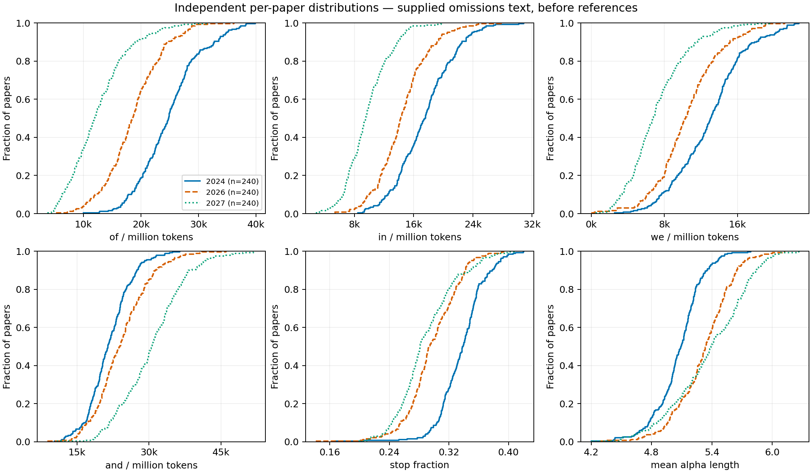
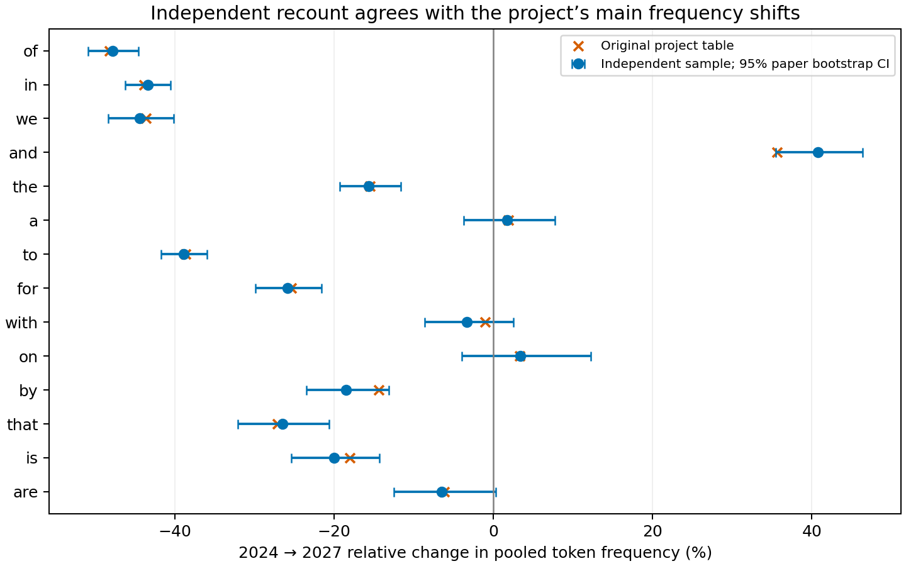
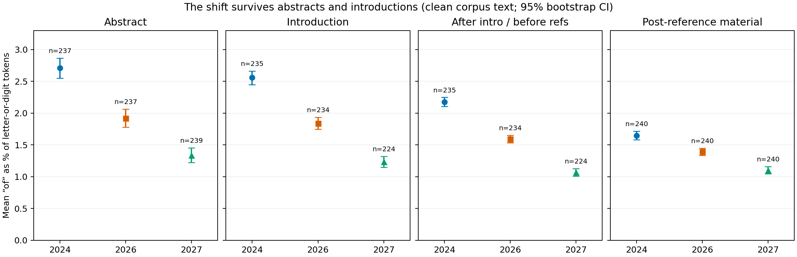
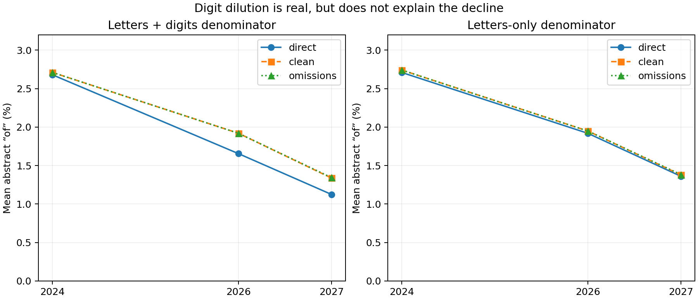

# Independent investigation: where did the function words go?

Investigation date: 14 October 2026 (Pacific). Independent branch:
`investigation/function-words-independent`. No changes to the main counting pipeline.

## Verdict

**Reproduced only in supplied corpus text. The causal explanation remains inconclusive.**

A fresh recount of 240 randomly selected records from each of ICLR 2024, 2026,
and 2027 reproduces the reported changes closely. The shift is already present in
abstracts and introductions, persists with an alphabetic-only denominator, and
appears in all three supplied text configurations. It does not require the
project's tokenizer, disclosure remover, cached counts, or normalization code.

This is independent *counting*, not independent *extraction*. All three text
configurations descend from the same extraction system. Attempts to acquire the
first ten randomized PDFs per year from OpenReview and the public PDF archive
failed with HTTP 403 responses. Browser verification also blocked OpenReview.
**Zero PDFs were downloaded, re-extracted, or visually verified.** The PDF
comparison program is provided, but its intended results must not be described
as completed.

The smallest decisive next question is: **Do hash-matched PDFs, visually checked
and extracted using MuPDF, contain the same low-function-word prose as the
dataset?** A larger corpus recount does not resolve that question.

## 1. Independence, sources, and sampling

| Item | Exact identity or rule |
|---|---|
| Research repository base | `ccfd54fb4d2731d715c0f5f350e02ed2fab9f434` |
| Dataset | `woog/open-text-detector-papers` |
| Dataset revision used | `cb5553e0c192c31c562a2822668c7f4ebbb9437a` |
| Newer HF HEAD observed, not analyzed | `bb454da057d027b9d4405d5f923beb12488f885a` |
| Extraction-source repository inspected | `woog97/open-text-detector` at `e7b1bbeb4cea1e4099d4dff7e7b6a0889cf9120b` |
| Source file populations | 2024: 6,150; 2026: 5,167; 2027: 42,344 |
| Sampling | 240 unique `(paper_id, pdf_sha256)` pairs per year, uniform without replacement from sorted pairs |
| RNG | Python `random.Random(20261014 + year).sample(..., 240)` |
| Exclusions | None at paper sampling; unavailable regions remain missing, never zero |
| Configuration matching | Same sampled PDF SHA-256 in `direct`, `clean`, `omissions` |
| Successful record checks | 720 papers × 3 configurations; all 2,160 calculated text hashes equal supplied text hashes |

The nine parquet files were downloaded directly from revision-qualified HF URLs,
using an independent downloader and revision-specific cache directory. Their
URLs, byte lengths, SHA-256 hashes, row counts, all 720 selected IDs and their
randomized order, text-region offsets, and the explicit stopword list are in
[`manifest.json`](../results/independent_function_words/manifest.json).
The extraction source inspected is a current code snapshot, **not proof that
these exact source bytes or binary versions produced the historical dataset**.

Primary measurements use only `[A-Za-z]+|[0-9]+`, lowercased. Each letter run or
digit run contributes one denominator token. No Unicode normalization,
dehyphenation, sentence segmentation, citation deletion, heading deletion,
disclosure deletion, or omission-marker deletion occurs in the primary counter.
Thus mathematical fragments, citation names, and marker-label words can count.
This deliberately simple definition is applied identically to every year.

For each paper/region the output includes all 14 requested words, counts,
rates per million total tokens, rates per million alphabetic tokens, both mean
token length and mean alphabetic-token length, alphabetic fraction, stopword
fraction, and token count. Stopwords are an explicit frozen list, independent
of the original project's NLTK filter. Its absolute stopword shares are therefore
**not directly interchangeable** with the project's 37%/32% figures.

Both unweighted paper means/medians and pooled count/denominator rates are
reported. Pointwise 95% percentile bootstrap intervals resample papers within
year, 2,000 times; the whole paper is the replicate, never the individual token.
Summary RNG is NumPy `default_rng(20261014 + year)`; ratio comparisons use
`default_rng(20261014)`, independently sampling the two years. Intervals have
no finite-population correction or simultaneous/multiplicity adjustment. They
measure sample variability within these supplied populations, **not extraction,
coverage, author-dependence, or provenance uncertainty**. This is an exploratory
investigation with a prespecified primary recount, not a registered causal test.

## 2. P0: independent reproduction

Closest comparison to the original headline: supplied `omissions` text before
the first reference heading/marker, with disclosures and marker labels retained.
Rates are pooled occurrences per million letter-or-digit tokens.

| Word | Project 2024 → 2027 | Independent 2024 → 2027 | Independent change, 95% CI |
|---|---:|---:|---:|
| of | 26,570 → 13,770 (−48.2%) | 24,725 → 12,916 | −47.8% [−50.9%, −44.5%] |
| in | 19,060 → 10,710 (−43.8%) | 17,437 → 9,874 | −43.4% [−46.2%, −40.6%] |
| we | 14,190 → 8,003 (−43.6%) | 12,985 → 7,225 | −44.4% [−48.3%, −40.1%] |
| and | 23,680 → 32,120 (+35.6%) | 21,591 → 30,386 | +40.7% [+35.5%, +46.4%] |

Different absolute rates are expected from the deliberately different tokenizer,
retained citations, markers/disclosures, and sampling. The relative shifts agree
closely; this is not exact numerical replication of the original estimand.
The original values above are from the committed
`results/full/body/top100_n1_raw_by_year.csv`, rounded as published there.



Every curve in this plot represents 240 papers, without smoothing or omitted
outliers. A broad distributional shift is reproduced. No claim of unimodality
or homogeneity follows from an ECDF, and a broad shift does not exclude
composition effects.

| Pre-reference omissions statistic: paper mean | 2024 | 2026 | 2027 |
|---|---:|---:|---:|
| Stopword fraction | 0.3376 | 0.2978 | 0.2892 |
| Mean token length, letters and digits | 4.909 | 5.123 | 5.154 |
| Mean alphabetic-token length | 5.074 | 5.322 | 5.377 |
| Alphabetic-token fraction | 0.9465 | 0.9417 | 0.9367 |
| Tokens | 5,323 | 5,249 | 5,082 |
| Median tokens | 5,302 | 5,190 | 4,960 |

Full-document clean-text mean lengths instead rise: 11,633 / 13,556 / 15,841
tokens. All means, medians, and their intervals for every requested measure,
region, configuration, and year are in
[`summary.csv`](../results/independent_function_words/summary.csv); individual
observations are in [`paper_metrics.csv.gz`](../results/independent_function_words/paper_metrics.csv.gz).



The title “function words disappearing” is too broad: the words do not move
together. In particular, `and` rises, while `a`, `on`, and `with` have much
smaller changes than `of`, `in`, and `we`. The source observations warrant
word-specific investigation, not a single inferred syntactic mechanism.

## 3. P1: where the change occurs

Regions are identified independently using line-anchored headings:

- Abstract: after an explicit abstract heading and before introduction; bounded
  to 100–10,000 characters. Numbers preceding introduction may remain.
- Introduction: after introduction and before a conservative top-level section
  2 heading, 300–20,000 characters later. Numbered list items `2. ...` do not qualify.
- Main-text proxy: from section 2 to references. It can contain figures,
  equations, tables, lists, and administrative sections; it is **not verified
  pure scientific prose**.
- Post-reference material: after the reference heading or first references
  omission marker. It contains remaining references and may contain appendices;
  it is **not labelled verified appendix text**.
- A separate first-500-token window after introduction tests dependence on the
  section-2 boundary.

The clean configuration avoids omission-boundary decisions while reducing raw
page-number/line-number contamination. Regions are matched by role across
cohorts, not by author/topic or same-paper resubmission identity.

| Region | Year | n / 240 | Mean “of” / million, 95% CI | Median, 95% CI |
|---|---:|---:|---:|---:|
| Abstract | 2024 | 237 | 27,104 [25,466, 28,657] | 27,027 [25,210, 29,070] |
| Abstract | 2026 | 237 | 19,193 [17,783, 20,631] | 18,018 [16,000, 19,737] |
| Abstract | 2027 | 239 | 13,372 [12,264, 14,544] | 12,579 [10,714, 14,218] |
| Introduction | 2024 | 235 | 25,586 [24,487, 26,632] | 25,040 [23,873, 26,076] |
| Introduction | 2026 | 234 | 18,403 [17,461, 19,340] | 18,275 [17,136, 19,417] |
| Introduction | 2027 | 224 | 12,321 [11,487, 13,218] | 10,760 [9,895, 11,887] |



**The collapse survives comparable abstracts and introductions.** It is not
localized to appended material. First-500-token introduction means are also
24,692 / 17,848 / 12,017 per million, with 237 / 237 / 240 available papers.

Manual inspection covered clean-text section-2 and reference boundary snippets
for the first ten randomized entries per year, plus fuller abstract/introduction
boundary examples for the first two per year. Of the 30 section-2 checks,
29 had a conservatively detected boundary and one was missing; detected endings
were plausible headings. All 30 reference boundaries inspected were reference
headings. These are text checks, **not PDF visual validation**. IDs and results
are recorded in `boundary_audit.csv`.

During development, the first implementation incorrectly treated a contribution
list item in 2027 paper `eK0PbGvky6` as section 2. The final parser excludes
`2.` list items, and all region counts were regenerated. The synthetic regression
case in `scripts/independent_selfcheck.py` preserves this failure mode. Missing
regions are not imputed; the larger missing-introduction fraction in 2027
remains a selection limitation. Fixed-window results help check this limitation.

## 4. P2: extraction and artifact tests

### Digits, cleanup, and omitted material

An actual artifact is present: raw text in 2026/2027 often contains extensive
review line-number columns. In sampled full documents, mean standalone lines
of at least three digits number 17 / 964 / 1,501 in `direct`, versus
17 / 25 / 29 in `clean`. Some such lines are table or equation values; this
diagnostic does not label every numeric line a review line number.

Raw abstract alphabetic-token fractions average 0.989 / 0.861 / 0.827.
Consequently, raw all-token normalization exaggerates the decline. However,
raw **alphabetic-only** abstract “of” means are 27,087 / 19,179 / 13,592 per
million. The 2024–2027 decline is still approximately 50%.



Across whole sampled documents, `clean` preserves 99.993%, 99.987%, and 99.925%
of `direct` “of” counts respectively. Thus direct-to-clean cleanup is not
selectively deleting half the instances. Omissions removes substantial material
(including references), but the effect already appears upstream in `direct`
and in abstracts where clean/omissions rates nearly coincide. This rejects
omission processing as a necessary or sufficient sole explanation, not the
possibility that it changes the measured size.

All three representations share a source extractor. Code inspection confirms
the described `pdftotext -bbox-layout` route and optional page OCR. Sampled
method labels indicate native-only extraction for 235 / 235 / 238 of 240
papers. Restricting to these labels leaves the abstract shift. The exact
historical Poppler/Tesseract binary versions were not available in the records;
method labels are not independent evidence of extraction fidelity.

The independent tokenizer performs no sentence splitting or section removal,
so neither original sentence segmentation nor original disclosure-removal
defects are needed to produce these unigram changes. Omission marker labels
remain in the primary counter; their counts and a full-text marker-stripped
sensitivity are saved in `extraction_diagnostics.csv`.

### Independent PDFs: blocked, not completed

`pdf_manifest.json` records 30 randomized candidates (ten per year), 60 download
attempts, and each error. OpenReview returned HTTP 403; the content-addressed
public archive returned HTTP 403 / Cloudflare error 1010 in focused probes.
The OpenReview API notes/PDF endpoints were also blocked in a focused probe.
The cloud browser reached a verification page for the 2027 candidate
`9BrRmvQPwf`; one reload did not clear it. No challenge was bypassed.

Thus there is **no matched independent PDF-extraction result**, no verified
template/font comparison, no visual evidence of selective word loss, and no
claim that the PDF prose itself has changed. The empty `pdf_metrics.csv` is an
explicitly unsuccessful stage, not zero lexical frequencies.

### Reproducible provenance defect in the original loader

The original `src/mlngrams/load.py::fetch` places files in
`CACHE_DIR/<config>/<venue>-<year>.parquet`, without the requested revision in
the path. If a file exists, the function returns it without checking revision
or content hash. Calling it with revision B after caching revision A can
silently read A. The MRE in `scripts/independent_diagnostics.py` constructs
only a temporary sentinel file and returns its old bytes for a new revision;
it performs no network request and does not modify the research pipeline.

See `cache_revision_mre.json`. **This defect is not an explanation established
for the published shift.** The present analysis downloaded revision-qualified
files freshly, recorded file hashes, and reproduced the shift anyway. The
original run's actual cached bytes cannot be reconstructed from a revision
label alone; future runs should use revision-keyed caches or verify hashes.

A smaller documentation discrepancy: `docs/corpus.md` describes titles as
always null, but the pinned records inspected here contain titles. This is a
documentation/provenance inconsistency, not evidence that lexical counts are
wrong. No unobserved history is inferred from it.

## 5. Bounded population checks and temporal limits

The following are descriptive checks inside the same supplied corpus. Header
version labels come from independent literal inspection of `direct`; title
groups are a coarse regex, not a validated research-area taxonomy.

| Clean abstract subset | n: 2024 / 2026 / 2027 | Mean “of” / million: 2024 / 2026 / 2027 |
|---|---|---|
| Under-review header only | 155 / 170 / 227 | 27,230 / 19,254 / 13,416 |
| Native-only method label | 232 / 232 / 237 | 27,112 / 18,882 / 13,333 |
| Abstract length 150–250 tokens | 184 / 189 / 155 | 27,382 / 19,035 / 11,941 |
| Language/LLM/reasoning/agent/prompt/retrieval in title | 45 / 71 / 82 | 24,172 / 19,455 / 12,636 |
| Other titles | 192 / 166 / 157 | 27,791 / 19,082 / 13,756 |
| Full document <12,000 tokens | 151 / 106 / 91 | 26,831 / 18,503 / 12,729 |
| Full document ≥12,000 tokens | 86 / 131 / 148 | 27,583 / 19,752 / 13,767 |

The thresholds were selected as simple exploratory controls, not tuned for a
p-value. The results weaken version mix alone, abstract length alone, and this
coarse topic split alone as complete explanations. They do **not** establish
exchangeable scientific populations, match authors/areas, or eliminate changes
inside each group. Full-token length includes references and is not an appendix
classification. No verified appendix-stratified or cross-venue replication was
completed.

For `of`, the clean abstract mean drops 29.2% from 2024 to 2026, then 30.3%
from 2026 to 2027; these intervals span two cohort years and one cohort year
respectively. This establishes both an earlier decline and an additional
2027 step in these sampled records, not the exact year of an abrupt break.
The **2017–2025 trajectory remains dependent on the original project's
measurements**; this investigation did not recount those years. It cannot
independently identify when a long-term trend began.

Different measures also have different trajectories. In clean abstracts,
stopword share is 0.3378 / 0.2950 / 0.2960: almost no further decline in 2027
despite the further collapse of `of`. In omissions abstracts mean alphabetic
token length rises to 2026 and then falls in 2027 (5.694 / 5.955 / 5.850).
These observations caution against treating every change as one increasing
“density” variable.

## 6. Competing hypotheses

| Hypothesis | Discriminating prediction and test | Evidence for / against | Outcome |
|---|---|---|---|
| H1: project counting/preprocessing error | The shift disappears with a new counter, fresh revision-qualified data, and no disclosure/sentence processing. | Closely reproduced across 720 independently sampled records; original cache defect exists but the fresh recount still shifts. | Rejected as the sole explanation for the supplied-text phenomenon; smaller pipeline distortions remain possible. |
| H2: source extraction artifact | Same-PDF MuPDF extraction or visually transcribed prose restores function words absent in supplied text. | Numeric line contamination is demonstrated; excluding digits does not eliminate the shift. All configs share extraction. No PDFs obtained. | Survives; decisive test blocked. |
| H3: corpus composition | Accurate prose from comparable populations stops shifting after genuine population/genre matching. | Growth and coverage/version differences are real corpus features. Several coarse controls retain the decline, but fine areas/authors/genres remain unmatched. | Survives; simple version/length/topic-only explanations weakened. |
| H4: genuine linguistic change | Independently extracted, visually verified, comparable prose retains the shift across cohorts. | Abstract/introduction counts are consistent with it. Independent extraction and strong population controls are absent. | Survives as a possibility, not established. |
| H5: mixed explanation | Artifact corrections reduce some effects while source-prose and/or composition effects remain. | Digit contamination changes raw rates, but a large supplied-text residual remains. | Survives; residual cause unresolved. |

No numerical hypothesis probabilities are assigned.

## 7. Evidence classification and stopping decision

**Independently reproduced observations:** large unigram changes in the pinned
source records; paper-level shifts; abstract/introduction changes; numeric
denominator contamination; near-preservation of `of` during direct-to-clean
processing; coarse sensitivity results; revision-cache collision behavior.

**Still dependent on the supplied corpus:** all text measurements, paper/PDF
identities and method labels until bytes can be checked, text provenance, and
coverage. **Dependent on the original pipeline:** published absolute rates,
2017–2025 trend and cross-venue claims used for context, and rhetorical-phrase
claims not recounted here.

**Rejected as sole explanations:** the original tokenizer; disclosure removal;
sentence segmentation; raw numeric denominator dilution; omissions processing;
appendix/reference accumulation alone. Under-review-only and length/topic
subsets additionally weaken specific composition stories, without rejecting H3.

**Unresolved:** whether supplied text faithfully represents the referenced
PDFs; font/text-layer corruption versus visible prose; other provenance errors;
fine population/genre effects; genuine changes in writing; their combinations.
Repeated boilerplate, inline math, tables, and heading/list proportions were not
exhaustively audited. The matched abstract result limits a pure bulk-composition
explanation but does not resolve these questions in source PDFs.

**Stop here under the requested stop condition.** No causal answer is justified
without checking source fidelity. Next, obtain the preselected PDFs below,
verify their hashes, extract with MuPDF and plain Poppler, and visually compare
abstracts and the first scientific-prose page. Count the same text regions and
inspect exact discrepancies in `of`, `in`, `we`, and `and`. If independent
extraction restores the words, localize the first differing extraction stage.
If it agrees and visual text confirms it, proceed to stronger population and
genre matching. Three PDFs per year can diagnose a gross artifact; the full ten
per year are a better first audit, not a population-level replication by themselves.

The exact 30 candidates and expected SHA-256 hashes are in `pdf_manifest.json`.
The first candidates are 2024 `jKTUlxo5zy`, 2026 `BFb4ACHayj`, and 2027
`9BrRmvQPwf`. No replacement sample should be silently selected based on the
observed lexical result or ease of access.

## 8. Reproduction and deliverables

From this branch's repository root, using Python 3.12:

```bash
python -m venv .venv-independent
. .venv-independent/bin/activate
python -m pip install -r scripts/independent-requirements.txt
python scripts/independent_selfcheck.py
python scripts/independent_function_words.py --n 240 --seed 20261014 \
  --years 2024 2026 2027 \
  --revision cb5553e0c192c31c562a2822668c7f4ebbb9437a
python scripts/independent_diagnostics.py
python scripts/independent_pdf_check.py --n 10
```

The recount fetches about 5.8 GB of parquet data (decimal GB); cached sample
text and PDFs stay under git-ignored `data/independent/`. Compare downloaded
file hashes to the committed manifest before treating a rerun as identical.
`independent_function_words.py` never imports `mlngrams`. Only the diagnostics
script's explicitly labelled cache MRE imports the original loader; project
tables are read only for the final comparison.

If authorized PDF files are supplied locally, put each at
`data/independent/pdfs/<expected-full-sha256>.pdf`, then run:

```bash
python scripts/independent_pdf_check.py --n 10 --offline
```

The PDF script verifies hashes before analysis, records MuPDF and Poppler
versions, writes per-region metrics, saves independent extraction text, and
renders page one for visual inspection. A hash mismatch is not accepted as a
matched extraction. `--offline` enables the next investigator to continue
without retrying blocked endpoints.

| Deliverable | Path |
|---|---|
| Independent downloader/counter and region logic | `scripts/independent_function_words.py` |
| Figures, sensitivity checks, cache MRE | `scripts/independent_diagnostics.py` |
| Hash-checked PDF continuation | `scripts/independent_pdf_check.py` |
| Denominator/boundary checks | `scripts/independent_selfcheck.py` |
| Frozen dependencies | `scripts/independent-requirements.txt` |
| Source and sampling manifest | `results/independent_function_words/manifest.json` |
| Per-paper and summary measurements | `paper_metrics.csv.gz`, `summary.csv` in that results directory |
| All 14 original/independent comparisons | `project_comparison.csv` |
| Composition, retention and extraction checks | `composition_checks.csv`, `word_retention.csv`, `extraction_diagnostics.csv` |
| PDF attempts and manual boundary audit | `pdf_manifest.json`, `boundary_audit.csv` |
| Figures plus source-data hash | `fig1`–`fig4` PNG/SVG and `figure_provenance.json` |

Source texts are not committed. Figures were rendered and visually inspected;
machine-readable tables are supplied alongside them. The scripts and report
are exploratory research artifacts, not changes to the main pipeline.

Procedural support: Scientific Critical Thinking v1.4, Statistical Analysis
v1.4, and Scientific Visualization v1.3 skills guided evidence separation and
presentation; their analysis code was not imported. Credit: Kassis, T.,
Agarwal, V., He, Y., Patel, D., and Brueckner, A. M. (2026), *Scientific Agent
Skills: A Library of Procedural Knowledge for Research Agents*,
[doi:10.48550/arXiv.2609.00065](https://doi.org/10.48550/arXiv.2609.00065),
bibliography checked against the current arXiv record (v2).
