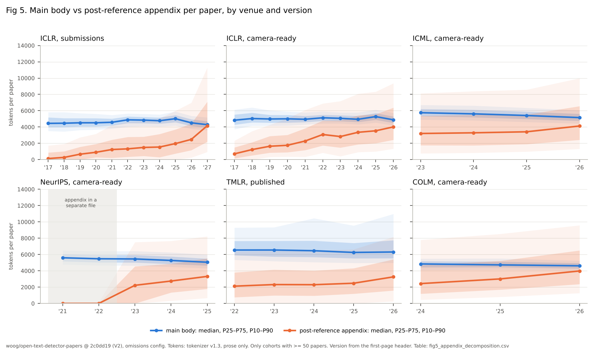

# V2 appendices and AI-use disclosures (Lane D)

_2026-10-15, Agent D (thread "Lane D: appendix growth and AI-use disclosures"). Corpus:
`woog/open-text-detector-papers` at the V2 pin `2c0dd192a3d3ba6605ed3f5ed5df145dddbdcb27`, `omissions`
config. Every number comes from a table in `results/v2/appendices/` or `results/v2/disclosures/`;
commands are at the end. Version strata (submission / camera-ready) come from the first-page header
labels of Gate 0 (`scripts/v2/version_mix.py`). Descriptive facts, interpretations and hypotheses are
marked as such. Nothing here is evidence about who or what wrote any text._

## Summary

**Appendices**

1. **V1.5 reproduces exactly.** Run on the V2 pin, restricted to V1 records with V1.5 definitions,
   all 297 rows of `length_quantiles_iclr.csv` match (`v1_reproduction.csv`). This is expected because
   no V1 record changed, and confirms that the scanner and the revision-keyed cache behave.
2. **The 7% → 47% rise is verified, and the complete ICLR 2024–2026 years barely move it.** Median
   raw post-reference share of characters: 7.2% (2017) → 46.9% (2027). The endpoints are unchanged by
   construction (ICLR 2017 and 2027 are byte-identical files). The newly completed years agree with
   V1's partial samples: median appendix tokens 2,048 / 2,425 / 2,897 in 2024 / 2025 / 2026, against
   V1's 2,045 / 2,354 / 2,961 (`iclr_added_vs_retained.csv`: added and retained records have the same
   medians to within ~5%). The cleaned appendix share of prose tokens goes 0.07 → 0.49.
3. **Main body flat, appendix grows, in every venue and both versions.** ICLR submissions: main body
   4,449 → 4,289 median tokens (8.5 → 9.5 pages), appendix 135 → 4,156 (1 → 12 pages). Wherever the
   appendix sits in the PDF, the main body is flat or shrinking and the appendix grows (fig 5).
4. **New: the growth step at the 2026 writing season is not ICLR-only.** Every cohort whose final text
   was written in 2026 shows its venue's largest single-year appendix increase, with the main body flat
   or falling (`yoy_median_change.csv`, medians, 95% bootstrap CI):

   | cohort (version) | appendix median change | main body median | cohort size |
   |---|---|---|---|
   | ICLR 2026 → 2027 (submissions) | **+1,672** (1,612–1,731) | 4,517 → 4,289 | 14,321 → 42,252 |
   | ICML 2025 → 2026 (camera-ready) | **+710** (568–901) | 5,414 → 5,155 | 3,257 → 6,328 |
   | COLM 2025 → 2026 (camera-ready) | **+975** (681–1,392) | 4,727 → 4,612 | 414 → 856 |
   | TMLR 2025 → 2026 (published) | **+780** (546–991) | 6,251 → 6,306 | 1,506 → 1,507 |
   | ICLR 2025 → 2026 (camera-ready, revised early 2026) | +478 (342–621) | 5,279 → 4,884 | 3,571 → 5,344 |
   | *controls:* ICML 2023 → 24, 2024 → 25 | +85 (−121–256), +124 (−76–284) | | |

   **ICLR-overlap papers excluded** (Lane E review; `yoy_overlap_excluded.csv`,
   `scripts/v2/appendix_overlap_exclusion.py`). A paper revised from ICLR for ICML gains about 640
   appendix tokens by itself, so the non-ICLR steps are recomputed without every paper matched to ICLR
   by exact title (this lane's pairs) or by text (Lane E's `e4_textpairs_*`), in every year with a match
   file. That drops 1,027 of 6,328 ICML 2026 papers, 520 ICML 2025, 184 TMLR 2026 and 57 COLM 2026.
   - ICML 2025 → 2026: **+818** (621–980). This is larger, not smaller, because the excluded ICML 2025
     overlap papers had longer appendices too. Without the overlap, the ICML controls are +27 (2023 → 24)
     and +2 (2024 → 25). Main body −253.
   - COLM 2025 → 2026: +942 (614–1,345).
   - TMLR 2025 → 2026: **+584** (358–835), down from +780. TMLR overlap papers carry part of the step,
     but it stays well above zero.
   - The match files cover ICLR 2024–2026 only. Overlap with earlier ICLR years or with other venues
     (NeurIPS rejections) is not removed.

   Interpretation: V1.5's strongest alternative for the ICLR 2027 jump was the doubled submission
   cohort. TMLR 2026 shows a step of similar relative size with an unchanged cohort size, and the step
   survives removing ICLR-overlap papers in ICML, COLM and TMLR. So cohort doubling cannot be the whole
   explanation, and the non-ICLR steps are not just ICLR papers moving venue. This is a descriptive
   coincidence in time. What drives it (writing tools, reviewer expectations, venue rules) is not
   tested here.
5. **Within the same paper, the appendix grows and the main body does not.** For ICLR 2026 → 2027
   resubmissions (237 exact-title pairs), the main body changes by −166 tokens (CI −250 to −114) and
   the appendix by +913 (680–1,092). A year earlier, 2025 → 2026 (152 pairs), the figures are −172 and
   +1,120. **The within-paper appendix gain is not larger into 2027 than into 2026**, so the 2027 jump
   in the cross-section is not explained by resubmitted papers growing faster. ICLR 2026 → ICML 2026
   (868 pairs, venue change) adds +636 appendix tokens, against +473 for ICLR 2025 → ICML 2025
   (`pairs_summary.csv`).
6. **What grew is still broad.** In ICLR submissions 2026 → 2027, implementation details (3,503 →
   7,030 mean characters), additional results (3,290 → 5,792), proofs (2,130 → 3,409) and ablations
   (638 → 1,039) all grew. In ICML, proofs fell (5,618 → 4,321 mean characters, 39% → 35% of papers
   with a proof section) while experimental material and examples/prompts rose (examples in 9% → 25%
   of papers). Papers with an appendix at least as long as the main body: ICLR submissions 23% (2026)
   → 49% (2027), ICML 21% (2023) → 37% (2026), COLM 24% → 43%. Growth stays spread out: the top
   decile's share of appendix tokens falls or holds in every venue.

**Disclosures**

7. **ICLR 2027 re-extracts to within one paper of V1.5** (41,005 vs 41,006 statements). The only code
   difference is a new table-of-contents skip, which fired on 30 papers. Lane C's body-language
   effects reproduce within |d| ≤ 0.012 (`lane_c/iclr-2027/`).
8. **ICLR 2026 is a new disclosure corpus, and it differs from 2027 in kind.** 57.8% of the complete
   2026 cohort (11,412 of 19,732 papers) carry an LLM-usage section, although the 2026 policy asked for
   one only when LLM use was "significant", allowed it in the appendix, and supplied no template
   (`policies.md`). 87% of these sections sit after the references (2027: 5%). Their median length is
   49 words (2027: 78). By provisional classifier labels, 46% are polish-only and 7% report drafting
   help; in 2027 the figures are 14% and 30%.
9. **The 2027 template, not the authors, accounts for most of the shared wording.** ICLR 2027 policy
   4-grams cover 21.8% of 2027 disclosure tokens and 0.5% of 2026 tokens. Authors' own wording is 60%
   in 2027, 81% in 2026, and 98% in COLM 2026 and ICML 2026 (`attribution.csv`). Statements that are
   mostly template or stock wording, or near-copies: 42% in 2027, 23% in 2026, 1–2% in COLM and ICML
   (`boilerplate.csv`). Shared stock wording exists without any template: "take full responsibility
   for" appears in 14% of 2026 statements, 12% of COLM and 10% of ICML statements.
10. **Denials are common even where nothing asks for them.** The V2 sentence-stance rules (provisional)
    find a denial in 47% of 2027 statements, where the template has a "We have not used ..." slot, but
    also in 41% of 2026, 38% of ICML 2026 and 27% of COLM 2026 statements, where there is no slot.
    Statements that deny all use are rare (0.8% in 2027, 3.2% in 2026). Hypothetical or example
    sentences are under 1% everywhere, and unfilled placeholders are 0.3% of 2027 sentences.
11. **Dedicated statements outside ICLR are a 2026 phenomenon and remain a minority.** COLM 2026:
    26.3% of papers (2025: 2.6%). ICML 2026: 4.8% (2025: 0.8%). TMLR 2026: 5.1%. NeurIPS 2025: 1.3%
    as sections, but its paper checklist carries an LLM-use question, so many NeurIPS 2025 papers state
    LLM use in checklist answers ("Answer: [NA] Justification: LLMs are only used to assist writing").
    That is a further 2025 disclosure corpus, not yet extracted.
12. **Validation (2026-10-21; see "Validation").** On 45 items labelled by Bobby and by two blind
    Claude Opus coders, the classifier's groups agree with the Opus coders on 34/40 statements
    (drafting precision 0.89, polish-only 1.0) and with Bobby on 25/40; the two Opus coders agree on
    every item, so they count as one machine reader. Group shares are usable for group-level
    description. The stance rules miss denials, so denial shares are probably undercounts.

## Appendices

### Definitions and population (unchanged from V1.5, plus version strata)

Main body, appendix, raw post-reference ratio, pages and heading categories are exactly V1.5's
(`docs/appendix-growth.md`; the scanner and the analysis functions are imported unchanged by
`scripts/v2/appendix_scan_v2.py` and `scripts/v2/appendix_analyze_v2.py`). The changes are:

- **Version strata for every venue** (Gate 0 first-page header labels), not only ICLR.
- **ICLR V2 population**: excludes papers under 2,000 characters, the ICLR template placeholder, and
  the 140 ICLR 2025 title-slug records (`population.csv`). ICLR 2025 is no longer restricted to the
  0–P id stratum, because the year is now 99.5% complete. This is a definition change, so the V1
  definition on V1 records is checked first and must reproduce exactly. It does (297/297 rows).
- **Other venues**: the same exclusions; cohorts under 50 papers are not plotted.

### Figure 5 and its table



`fig5_appendix_decomposition.csv` holds P10/P25/P50/P75/P90 and means of main-body and appendix tokens,
appendix share (cleaned and raw), and pages, for every venue × year × stratum, with the corpus revision
in each row. Companion figures:
- `fig5b_appendix_share_by_venue.png`: relative share, submissions and camera-ready side by side.
- `fig5c_appendix_ecdf.png`: paper-level distributions.
- `fig5d_composition.png`: heading categories, ICLR submissions and ICML.

Medians (all from `length_quantiles.csv`):

| cohort | years | main tokens | appendix tokens | appendix share | main / appendix pages |
|---|---|---|---|---|---|
| ICLR, submissions | 2017 → 2026 → 2027 | 4,449 → 4,517 → 4,289 | 135 → 2,485 → 4,156 | 0.03 → 0.36 → 0.49 | 8.5/1 → 9.5/8.5 → 9.5/12 |
| ICLR, camera-ready | 2017 → 2026 | 4,838 → 4,884 | 712 → 4,016 | 0.13 → 0.45 | 9/3 → 10/13 |
| ICML, camera-ready | 2023 → 2026 | 5,756 → 5,155 | 3,207 → 4,126 | 0.36 → 0.44 | 8.5/10 → 9/12 |
| NeurIPS, camera-ready | 2023 → 2025 | 5,452 → 5,053 | 2,221 → 3,313 | 0.29 → 0.39 | 10/7 → 10/9.5 |
| TMLR, published | 2022 → 2026 | 6,546 → 6,306 | 2,118 → 3,255 | 0.23 → 0.33 | 12.5/8 → 13/11 |
| TMLR, submissions | 2022 → 2026 | 5,996 → 6,201 | 1,012 → 2,601 | 0.14 → 0.28 | 11.5/4 → 12.5/9 |
| COLM, camera-ready | 2024 → 2026 | 4,842 → 4,612 | 2,430 → 3,978 | 0.33 → 0.47 | 10/7.5 → 10/13 |
| CoRL, camera-ready | 2023 → 2025 | 4,510 → 4,325 | 2,126 → 2,369 | 0.32 → 0.35 | 8/6.5 → 8.5/7 |
| EMNLP 2023 (no version header) | 2023 | 4,789 | 1,289 | 0.22 | 8.5/3.5 |

### Comparing venues only after formatting and submission rules

- **Where the appendix can be at all.** NeurIPS 2021–22 and CoRL 2021–22 required or allowed
  appendices as separate files, so their zero appendix is a rule artifact, as V1.5 found. The step into
  2023 (NeurIPS +2,221 tokens) is a policy change and is excluded from every trend statement.
- **Version.** Camera-ready papers carry more appendix than submissions of the same year: ICLR 2026
  has 4,016 vs 2,485 median tokens, and TMLR 2026 3,255 vs 2,601. Only ICLR follows the full submitted
  population, so ICLR submissions are compared with ICLR submissions, and other venues' camera-ready
  papers with ICLR camera-ready papers. TMLR's added records are mostly submissions; pooled, TMLR shows
  a spurious decline (Lane A, Gate 1).
- **Format.** ICML is two-column. Its main body has more tokens per page (5,155 tokens on 9 pages vs
  ICLR's 4,289 on 9.5), and the omissions config removes about twice as many display equations per
  ICML paper (Gate 0). **Levels are therefore not compared across venues; only within-venue
  trajectories are.**
- **Page limits.** ICLR's main body follows its limit (10 pages in 2025, 9.5 median in 2026–27).
  TMLR has no page limit and still grows its appendix (+780 in 2026), so a page cap is not the only
  pressure.

### Within-paper change

`pairs_summary.csv` (exact normalized-title matches; titles ≥ 25 characters, unique within each
venue-year; medians with 1,000-resample bootstrap CIs):

| pair | n | main body change | appendix change | share whose appendix grew |
|---|---:|---|---|---:|
| ICLR 2025 → ICLR 2026 (resubmission) | 152 | −172 (−268 to −105) | **+1,120** (709–1,349) | 84% |
| ICLR 2026 → ICLR 2027 (resubmission) | 237 | −166 (−250 to −114) | **+913** (680–1,092) | 78% |
| ICLR 2025 → ICML 2025 (venue change) | 423 | +128 (103–172) | +473 (360–580) | 74% |
| ICLR 2026 → ICML 2026 (venue change) | 868 | +337 (300–372) | +637 (552–694) | 78% |

Readings:
- Facts: resubmitted papers move text out of the main body and grow the appendix by about a
  thousand tokens a year. The 2026 → 2027 gain is not larger than the 2025 → 2026 gain.
- Interpretation: the 2027 cross-sectional jump (+1,672) is therefore mostly a between-paper
  difference. The papers submitted in 2027 have longer appendices than the papers submitted in 2026,
  but resubmitted papers did not grow faster than usual. That fits either a changed population of
  submitters or a field-wide change in how new papers are assembled. This analysis cannot separate the
  two.
- The ICLR → ICML main-body increase is the format change (two-column ICML packs more tokens into the
  page limit), not a writing change.

### Composition: proofs, experiments, ablations, prompts

`composition.csv` (V1.5 heading taxonomy, 85% agreement with hand labels; mean characters per paper):

| category | ICLR subm. 2017 | 2023 | 2026 | 2027 | ICML 2023 | ICML 2026 | COLM 2024 | COLM 2026 |
|---|---:|---:|---:|---:|---:|---:|---:|---:|
| implementation / experimental details | 538 | 2,369 | 3,503 | 7,030 | 2,131 | 4,722 | 4,026 | 5,282 |
| additional results | 377 | 2,241 | 3,290 | 5,792 | 2,371 | 4,814 | 3,121 | 6,043 |
| proofs / theory | 459 | 2,102 | 2,130 | 3,409 | 5,618 | 4,321 | 416 | 1,209 |
| examples / prompts | 88 | 517 | 2,143 | 2,123 | 396 | 2,581 | 3,783 | 5,995 |
| data / benchmarks | 181 | 930 | 1,816 | 2,719 | 840 | 1,822 | 1,880 | 2,816 |
| ablation | 53 | 357 | 638 | 1,039 | 271 | 870 | 260 | 1,242 |
| related work | 23 | 316 | 588 | 748 | 268 | 578 | 616 | 746 |
| limitations / discussion | 14 | 294 | 463 | 468 | 341 | 647 | 489 | 771 |
| unsectioned | 1,127 | 1,311 | 3,646 | 5,808 | 9,198 | 9,569 | 2,450 | 4,008 |

- Experimental material (implementation, results, data, ablations) drives the 2026–27 growth in all
  three venues.
- Proofs plateau: in ICLR the share of submissions with a proof section is 27–28% (2021–23), 21–25%
  (2024–27). In ICML proof text falls in absolute terms.
- Examples and prompts are the LLM-era category. In ICLR submissions, papers with one rose from 15%
  (2023) to 26% (2026), and in ICML from 9% to 25%. In ICLR it did not grow further in 2027 (22%).
- ICML's "unsectioned" share is large (about 9k characters per paper): two-column ICML appendices use
  headings the lettered-heading scanner misses more often. ICML composition shares are therefore
  coarser than ICLR's.

## AI-use disclosures

### What changed between V1.5 and V2

- **ICLR 2027 is unchanged** (byte-identical), and its extraction reproduces
  (`reproduction_iclr2027.csv`): found 41,005 vs 41,006; clean 39,343 vs 39,351; drafting 11,773 vs
  11,766; polish-only 5,358 vs 5,358. All differences come from the new table-of-contents skip, which
  fired on 30 papers.
- **New cohorts.** ICLR 2026 is complete (19,732 papers vs V1's 26%). ICML 2026, COLM 2026, TMLR 2026
  and NeurIPS 2025 are new. Earlier years serve as a false-positive floor: 0.06–0.8% of pre-2026
  ICLR, ICML and NeurIPS papers produce a "statement", and these are mostly extractor false positives
  (paper titles and prompts containing "LLM ... use").
- **Extraction tiers.** V1.5's clean tier treats a statement that runs to the end of the text as
  suspect. That fits 2027, where statements sit in the main text, but in 2026 most statements are the
  last appendix section, and 3,870 of them ended at the end of the text. A V2 tier (`tier_v2` in
  `scripts/v2/disclosures_analyze_v2.py`) accepts such a statement when it holds no omission marker, is
  at most 3,000 characters and has no bibliography residue. ICLR 2026 clean: 6,607 (V1.5 rule) → 10,069
  (V2 rule). For 2027 the V2 tier adds 550 statements (39,343 → 39,893). The reproduction uses the V1.5
  tier, the cross-cohort phrase work uses the V2 tier, and Lane C on ICLR 2026 uses the V2 tier
  (`lane_c_v2_prereg.md`). This is a methodological change and is reported as such.

### Inventory (`inventory.csv`)

| cohort | papers | with a statement | after the references | median words | drafting / polish-only / other / none (provisional) |
|---|---:|---:|---:|---:|---|
| ICLR 2027 (submissions) | 42,344 | 96.8% | 5% | 78 | 30 / 14 / 54 / 0.7% |
| ICLR 2026, all | 19,732 | 57.8% | 87% | 49 | 7 / 46 / 35 / 2.4% |
| ICLR 2026, submissions | 14,337 | 56.4% | 86% | 49 | 7 / 45 / 35 / 2.5% |
| ICLR 2026, camera-ready | 5,344 | 61.9% | 88% | 48 | 7 / 50 / 36 / 2.3% |
| COLM 2026 | 856 | 26.3% | 71% | 56 | 18 / 13 / 64 / 1.4% |
| TMLR 2026 | 3,027 | 5.1% | 59% | 51 | 11 / 25 / 57 / 0% |
| ICML 2026 | 6,555 | 4.8% | 85% | 67 | 7 / 27 / 58 / 1.4% |
| NeurIPS 2025 | 6,130 | 1.3% | 74% | 44 | (68 statements; too few) |
| ICLR / ICML 2025 | 11,618 / 3,422 | 0.6% / 0.8% | | | mostly false positives |

**Statements missed by the heading rule.** Papers with no recovered section were also scanned for a
sentence pairing an AI-tool term with a writing term and a self-reference ("We used LLMs to polish the
writing"). Such candidates appear in 9.2% of ICLR 2026 papers without a section, 6.8% of COLM 2026,
6.9% of NeurIPS 2025 and 1.1% of ICML 2026. In 12-item spot checks, Claude judged the candidates real
author disclosures in 11/12 (ICLR 2026), 8/12 (ICML 2026) and 11/12 (NeurIPS 2025, almost all
checklist answers). Many ICLR 2026 misses have headings without a use word ("WRITING DETAILS",
"ABOUT LARGE LANGUAGE MODELS", "LLM DISCLAIMER"). The true ICLR 2026 statement rate is therefore about
61–62%, not 58%. These checks are Claude's, not a human's. Five such sentences are in Bobby's sample
(part D).

**Interpretation, with care.** Most ICLR 2026 authors wrote a statement that the policy did not
require of them. The 2026 statements are short and polish-centred. The 2027 statements are longer
and, by the classifier's reading, report drafting help four times as often. Two readings fit:
- The template and the mandatory Required/Recommended lists prompted fuller reporting.
- Practice changed between the two writing seasons.

The data cannot separate these. The same authors' statements across years (237 resubmission pairs) are
the cheapest test (see "Next").

### Template, stock wording and boilerplate

| cohort | ICLR 2027 policy wording | stock wording (shared 6-grams) | authors' own | mostly template/stock or near-copy |
|---|---:|---:|---:|---:|
| ICLR 2027 | 21.8% | 18.5% | 59.7% | 42% |
| ICLR 2026 | 0.5% | 18.4% | 81.0% | 23% |
| COLM 2026 | 0.5% | 1.9% | 97.6% | 2% |
| ICML 2026 | 0.2% | 1.6% | 98.2% | 1% |

Stock wording is a 6-gram found in at least max(5, 0.13% of the cohort's) statements, the V1.5 rate
scaled to cohort size, so small cohorts have a lower bar but also fewer chances to share. Exact copies:
9.8% of 2027 statements and 14.1% of 2026 statements (`boilerplate.csv`). The 2026 copies are short
formulas repeated verbatim ("LLMs were used only to polish the writing").

**Lexical bundles** (`bundles.csv`, 4-grams in ≥ 2% of statements):
- 2027: "used generative ai tools" (45% of statements), "responsibility for the final" (60%), "for the
  final content" (51%). All of these are template.
- 2026: "take full responsibility for" (14%), "the preparation of this" (13%), "a large language
  model" (10%), "did not contribute to" (7%).
- ICML 2026 shares the 2026 ICLR bundles almost exactly ("the preparation of this" 13%, "take full
  responsibility for" 10%). COLM 2026 adds "verified by the authors" (9%) and "were not used to" (5%).

**Phrase frames** (`frames.csv`): 2027 frames are frozen ("for the * content": final 97%). In 2026,
"the authors * full" takes take 81%, bear 5%, retain 5%, assume 5%.

**Keyness** (`keyness.csv`, log-odds with informative prior):
- 2026 statements say "LLMs", "large language models", "grammar", "solely", "clarity", "employed",
  "contributions". 2027 statements say "generative AI tools", "this work", "claims", "code",
  "reviewed", "final content". Vocabulary follows each year's policy wording.
- COLM 2026 names tools and contexts ("Claude", "Claude Code", "Opus", "judge", "plots", "as described
  in") more than ICLR 2026, which centres on language ("grammar", "polishing", "readability").
- The ICML 2026 vs 2027 comparison is contaminated: ICML statements more often run on into math and
  tables (single-letter tokens rank top), so it is not interpreted.

### Affirmative claims, denials, hypotheticals (`polarity.csv`)

New in V2 (provisional; `sentence_stance` in `scripts/v2/disclosures_analyze_v2.py`). Each sentence is
classed with the frozen classifier's clause splitter and negation test as one of: affirmative use
claim, denial, mixed, hypothetical/example, unfilled placeholder, attestation (responsibility or
review), or other. Papers are then classed by their sentences.

| cohort | use only | use + denial | denial only | no claim | any attestation |
|---|---:|---:|---:|---:|---:|
| ICLR 2027 | 52.7% | 46.0% | 0.8% | 0.5% | 90.9% |
| ICLR 2026 | 53.1% | 37.7% | 3.2% | 5.7% | 31.9% |
| COLM 2026 | 72.3% | 25.4% | 1.4% | 0.5% | 43.2% |
| ICML 2026 | 55.8% | 36.6% | 1.7% | 5.8% | 28.8% |
| TMLR 2026 | 68.3% | 26.1% | 2.1% | 2.8% | 33.8% |

- Attestation is the template's signature: 91% of 2027 statements vs 29–43% elsewhere.
- Hypothetical or example sentences are rare (≤ 1% of sentences) and so are unfilled placeholders
  (0.3% of 2027 sentences). Neither is a material source of misclassification.
- Denials ("not used for ideation or analysis") are common without any template slot: 38% of ICML
  2026 and 41% of ICLR 2026 statements contain one. Non-use is mostly stated as a boundary around
  use, not as abstention.

### Disclosures against paper bodies (Lane C, preregistered)

Preregistered in `results/v2/disclosures/lane_c_v2_prereg.md` before any V2 body feature was computed.
Body features, controls (topic-matched, seeded permutation) and the frozen classifier are Lane C's
V1.5 pipeline, reused unchanged.

- **ICLR 2027 reproduces.** Every contrast is within |d| 0.012 of V1.5: drafting vs polish-only papers,
  "we propose" d_adj −0.399 (V1.5 −0.411), "a novel" −0.216, AI-word rate −0.079. Own-body overlap
  enrichment +0.0569 (V1.5 +0.057).
- **ICLR 2026, V2 tier (664 drafting vs 4,638 polish-only papers; `lane_c/iclr-2026-tierv2/`).** The
  prediction was the same sign on the three strongest 2027 features. Two of three hold:
  "we propose" d_adj −0.237 (CI −0.329 to −0.144, q 0.001) and "a novel" −0.111 (−0.193 to −0.026,
  q 0.02). **AI-word rate does not replicate**: −0.024 (−0.102 to 0.049). Other 2027 effects that
  recur: "test whether" +0.171, vocabulary diversity (MATTR) +0.179, bundle repetition −0.195.
  "held fixed", percentage points and token length do not.
- The "other use vs polish-only" contrast gives the same pattern (we propose −0.225, a novel −0.102),
  and drafting vs "polish-plus" papers (polish together with another non-drafting use, 2,997) is null
  on every feature. So the gradient separates
  **polish-only papers from all the rest**, not drafting from the rest.
- Longer and more specific statements go with more diverse, longer-word bodies (ρ ≈ 0.11–0.13).
- Interpretation: the body-language difference between polish-only and other disclosers does not depend
  on the 2027 template or the 2027 cohort. Whether it reflects how people write or what kind of paper
  they write (e.g. empirical vs method papers) is not settled by the topic controls. Nothing here
  says who wrote the bodies, and the groups are provisional classifier labels.

- **Overlap prediction holds.** A statement shares more vocabulary with its own paper's body than with
  topic-matched control bodies by +0.050 of author word types (CI 0.048–0.053; 2027: +0.057). The
  stopword-profile fingerprint stays near zero (+0.009; 2027 +0.010). As in 2027, the enrichment is
  smallest for polish-only statements (+0.018) and larger for drafting (+0.045) and polish-plus
  (+0.066): statements that say more about use also echo more of their paper.
- **Word scan:** 103 of 5,000 body words differ between drafting and polish-only papers at q < 0.05
  (70 more frequent in drafting papers), against 0–1 in five shuffled-label runs. Words more frequent
  in drafting papers include "assistant", "future", "avenues", "style" and "edits"; less frequent,
  "outperforms", "extensive", "thereby" (`lane_c_scan.csv`). Not interpreted beyond existence.

### Validation (one human and two blind Claude coders, 2026-10-21)

`results/v2/disclosures/labelling/sample.csv` lists 45 items (seed 20261015):
- Part A: 15 ICLR 2027 statements from the held-out test2 set that already carry V1.5 Claude
  coder-1 labels.
- Part B: 15 ICLR 2026 statements.
- Part C: 6 COLM 2026 and 4 ICML 2026 statements.
- Part D: 5 in-text candidate sentences.

**Readers.**
- Bobby labelled all 45 on the labelling page. He describes himself as an inexperienced annotator, so
  his labels are treated as one noisy coder, not as ground truth.
- Two Claude Opus coders labelled the same 45 items blind (`scripts/v2/compare_coders.py`). Each saw
  only the item texts and the page's own instructions, and none of the classifier labels, the rule
  labels, Bobby's labels or each other's. One coder worked through the items in reverse order.
- **The two Opus coders agree on every item** (stance, group and every use tag, 45/45). Their notes
  differ in wording, so this is not one file copied, but it is the V1.5 caveat at full strength: two
  runs of one model are not two independent readers. Read them as one careful machine reader.

**Results** (`agreement.csv` from `score_labels.py`, `coder_agreement.csv`,
`classifier_vs_consensus.csv`; 40 statements in parts A–C unless stated):

| comparison | group agreement (κ) | stance agreement (κ) |
|---|---|---|
| Opus A vs Opus B | 40/40 (1.0) | 40/40 (1.0) |
| Bobby vs Opus | 28/40 (0.58) | 19/40 (0.16) |
| classifier v2 / stance rules vs Opus | **34/40 (0.78)** | 27/40 (0.42) |
| classifier v2 / stance rules vs Bobby | 25/40 (0.48) | 22/40 (0.08) |
| Opus vs V1.5 coder 1 (part A) | 15/15 | |
| Bobby vs V1.5 coder 1 (part A) | 9/15 | |

Classifier v2 against the majority of the three readers, which here always equals the Opus pair:
- drafting precision 8/9 = 0.89 (Wilson 0.57–0.98), recall 8/8;
- polish-only precision 16/16 = 1.0 (0.81–1.0), recall 16/20 = 0.80 (0.58–0.92);
- the six group errors: three polish-only statements called "other use", two "unknown" statements
  called "other use", one polish-only statement called drafting. By part: A 14/15, B (ICLR 2026)
  11/15, C (COLM/ICML) 9/10.

Where Bobby and the Opus coders differ, the differences are systematic, not random:
- **Bobby never used "use + denial".** He marked 42 of 45 items "claims use"; the Opus coders called
  21 of those "use + denial" ("only for grammar; not for ideas"). That accounts for most of the stance
  gap.
- **Bobby ticks drafting more often**: 19 of 40 statements, against 8 for the Opus coders, mostly
  statements about editing or polishing ("refine phrasing", "improve clarity"). The page defined
  drafting as "writing or rewriting text, condensing", and editing is a borderline case under it.
- On the 5 in-text sentences (part D), Bobby calls all 5 disclosures, the Opus coders 4 (L30 describes
  prompting a model in the research, not writing help). On the 3 statements Bobby marked "not a
  disclosure", the Opus coders agree.

**What this means for the shares in this document.**
- **Drafting / polish-only / other groups (classifier v2): usable for group-level description**, as
  in V1.5. Against a careful reader they meet V1.5's bar on point estimates (precision ≥ 0.85, recall
  ≥ 0.80), with wide intervals at n = 40, and the errors lean toward "other use" rather than toward
  drafting. Against Bobby's labels drafting recall is 0.47, almost entirely from his broader reading of
  drafting. ICLR 2026 is the weakest cohort (11/15).
- **Stance shares (sentence-stance rules): not validated.** The rules miss denials: of 21 statements the
  Opus coders read as "use + denial", the rules called 8 "use only", most of them ICLR 2026 (part B
  stance agreement 7/15). The denial shares in this document (41% of ICLR 2026, 38% of ICML 2026) are
  therefore probably **undercounts**, and the "use only" shares overcounts.
- No human reader has validated the categories to the standard a category-level claim needs. One
  noisy human, one model run twice, and 45 items detect gross failure; they do not certify precision.

## Negative results and corrections (also in `docs/v2-negative-results.md`, Lane D)

- **V1.5 extraction tiers do not transfer to ICLR 2026.** Under the V1.5 rule, 42% of 2026 statements
  are "suspect", mostly because the statement is the last thing in the paper. Using the V1.5 clean
  tier for 2026 would keep mainly the 13% of statements placed in the main text. Corrected with the V2
  tier as a separate sensitivity definition.
- **The heading rule misses statements in 2026.** About 9% of 2026 papers without a recovered section
  disclose in a sentence or under an unusual heading. Prevalence figures are lower bounds.
- **The 2027 appendix jump is not a resubmission effect.** The within-paper gain into 2027 (+913) is
  not larger than into 2026 (+1,120).
- **The "unchanged" pre-2026 statements are mostly extractor noise** (0.06–0.8% of papers); don't
  read them as early disclosure.
- **ICML statement extraction overruns more often** (the keyness list is dominated by math tokens),
  so ICML phrase comparisons are not interpreted.
- The V1.5 Lane D review file `docs/v1.5-review.md` and its blind labels
  (`results/review/blind_labels_laneb_test*.csv`) are cited in V1.5 docs but are not in the
  repository. Part A of the new sample replaces that check with a human one.

## Next

1. Score Bobby's labels (`score_labels.py`) and restate every category share with its validation
   result.
2. Same authors, two policies: compare the 2026 and 2027 statements of the 237 resubmission pairs.
   This separates "the template prompted fuller reporting" from "practice changed".
3. Extract the NeurIPS 2025 checklist LLM answers as a 2025 disclosure corpus written before the 2026
   season.
4. Repeat the appendix decomposition on NeurIPS 2026 when it enters the dataset: it is the next
   2026-written cohort that is not tied to ICLR's cohort doubling.

## Reproduce

```bash
python3 scripts/v2/version_mix.py --revision 2c0dd192a3d3ba6605ed3f5ed5df145dddbdcb27 --out data/v2/version
python3 scripts/v2/appendix_scan_v2.py --out data/v2/appendix          # ~2.5 h on 4 cores (145k papers)
python3 scripts/v2/appendix_analyze_v2.py data/v2/appendix results/v2/appendices
python3 scripts/v2/appendix_overlap_exclusion.py data/v2/appendix results/v2/appendices
python3 scripts/v2/disclosures_extract_v2.py --out data/v2/disclosures  # ~1 h on 2 cores
python3 scripts/v2/disclosures_analyze_v2.py
python3 scripts/v2/lane_c_v2.py --cohort iclr-2027                      # reproduction
python3 scripts/v2/lane_c_v2.py --cohort iclr-2026 --tier v2
python3 scripts/v2/labelling_sample.py
python3 scripts/v2/score_labels.py <exported labels dir>
```

Requires `scikit-learn` and `scipy` for the Lane C scripts (not in `requirements.txt`; Lane C used them
in V1.5 too). Intermediates (`data/v2/`) are git-ignored and hold disclosure text.
