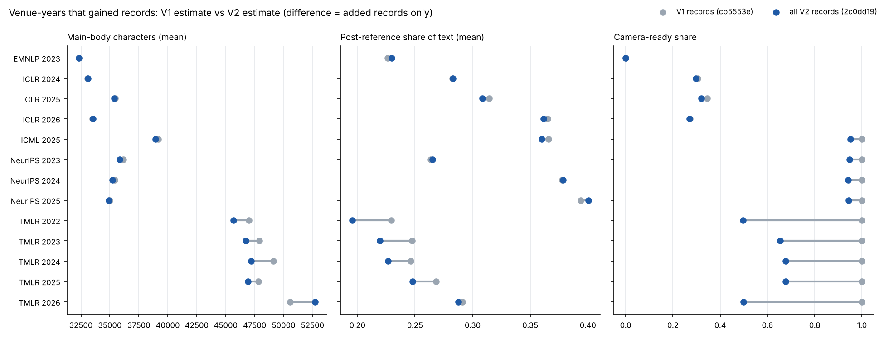

# V2 corpus diff: provenance and record-level changes (Gate 1, Lane A)

_2026-10-15, Lane A. Compares dataset revision `cb5553e0c192c31c562a2822668c7f4ebbb9437a` (V1) with
`2c0dd192a3d3ba6605ed3f5ed5df145dddbdcb27` (V2). Inventory, cohorts and the cache fix are in
`docs/v2-corpus-inventory.md`. Tables are in `results/v2/inventory/` and `results/v2/diff/`. Everything
here is descriptive and no paper text is stored._

## Gate 1 answer

| Question | Answer | Evidence |
|---|---|---|
| Were records added, removed or modified? | **Added only.** 52,128 records were added and 0 removed. | `record_changes.csv`, `membership.csv.gz` |
| Were existing papers re-extracted? | **No.** All 93,249 V1 records have the same `text_sha256` in `omissions`, `clean` and `direct`. Spot comparisons of the texts themselves agree, and `text_sha256` is the SHA-256 of the text. | `record_changes.csv`; check in the inventory doc |
| Were PDFs replaced by other versions? | **No.** Every V1 `paper_id` keeps its `pdf_sha256`. | `record_changes.csv` |
| Did extraction methods change? | **No.** Every row of both revisions uses `positioned-clean-v2`, and the poppler/OCR mix is the same in retained and added records. | `extraction_provenance.csv` |
| Did records move between venue-years? | **No.** `conference` and `year` equal the filename in every V2 row. | `corpus_diff.py` output |
| Are caches revision-safe? | **Yes, now.** The cache is keyed by commit sha and checked against the Hub's LFS SHA-256 (6 tests). V1's committed tables match `cb5553e` exactly in all 31 venue-years. | `tests/test_cache.py`, `v1_cache_consistency.csv` |
| Does the expansion change descriptive estimates? | **ICLR and the accepted-paper venues: barely.** Main-body length moves < 1% and post-reference share < 2%. ICLR 2025's camera-ready share falls 34.4% → 32.0%. **TMLR: substantially**, because the additions are mostly submissions. | `v1_v2_structure_delta.csv`, figure below |

So the V1→V2 change in any per-venue-year estimate has exactly one source, the **added records**. The
"modified text" and "methodology" terms of the revision waterfall (figure 7, Lane B) are identically
zero at the data level. Lane B's methodology term covers only analysis changes that V2 introduces
on purpose.

## Record-level change summary

| | retained (byte-identical) | re-extracted | PDF replaced | added | removed | moved |
|---|---:|---:|---:|---:|---:|---:|
| `omissions` | 93,249 | 0 | 0 | 52,128 | 0 | 0 |
| `clean` | 93,249 | 0 | 0 | 52,128 | 0 | 0 |
| `direct` | 93,249 | 0 | 0 | 52,128 | 0 | 0 |

The three configs classify every record identically. Per venue-year counts are in `record_changes.csv`.
The added records came in 61 dataset commits between 2026-10-14 21:42 and 2026-10-15 06:59 UTC
(`dataset_commits_since_v1.txt`), in chunks of up to 1,000 papers:

- ICLR 2024, 2025, 2026 (+1,154, +5,458, +14,565);
- COLM 2026 (+856), CoRL 2025 (+263), EMNLP 2023 (+800);
- ICML 2023–2026 (+1,828, +2,610, +2,253, +6,555);
- NeurIPS 2023–2025 (+2,513, +3,542, +4,961);
- TMLR 2022–2026 (+254, +332, +575, +1,059, +2,550).

**Records come in by key, so a record is either present or absent.** In this update nothing touched an
existing row. That is a fact about this revision pair, not a guarantee. ICLR 2027 is a submission
snapshot (catalogue of 2026-10-04), and authors can upload revised PDFs during rebuttal. If woog
re-crawls ICLR 2027, the same `paper_id` could come back with a new `pdf_sha256`. Any later revision
must be diffed with `scripts/v2/corpus_diff.py` before use.

## How the added records differ from V1 records



The figure shows means per venue-year over records with at least 2,000 characters, for the venue-years
that had V1 records. Structure comes from `scripts/v2/structure_scan.py`:

- **main body** = `omissions` text before the first `⟦references omitted⟧`, as in V1's `main_body()`;
- **post-reference** = text after the last references marker.

The figure plots character counts of omissions text, with no statement or checklist cutting. Lane D
owns the real appendix analysis; this is only a check of whether the added records are structurally
different from V1's.

**ICLR 2024–2026.** The added records look like the V1 records. Median main body is 33.2k vs 33.1k
characters (2024), 35.4k vs 35.5k (2025) and 33.5k vs 33.4k (2026), and median pages are identical.
Two differences:

- **2025:** the V1 records have more camera-ready papers (34.4% vs 29.1%) and slightly longer
  post-reference text (median share 0.320 vs 0.305). That fits V1's known over-representation of
  accepted papers in the `Q–z` and title-slug strata.
- **2026:** the V1 crawl was representative. Published share 27.3% vs 27.0%, post-reference share
  0.379 vs 0.370.

So V1's ICLR length and appendix results should carry over to V2 almost unchanged. V1's choice to use
only the `0–P` stratum for 2025 now has a full-year check.

**NeurIPS 2023–2025 and ICML 2025.** Within the camera-ready stratum, added and V1 records match
(`structure_by_status_version.csv`). NeurIPS 2024 median main body is 35.2k vs 35.3k and post-reference
share 0.377 vs 0.376. ICML 2025 is 38.8k vs 39.0k and 0.358 vs 0.368. The whole-year means move only
because V2 adds 5–8% public submission versions. Those are shorter: NeurIPS 2023 submissions have a
median of 12 pages vs 21 for camera-ready, because they carry no appendix in the PDF. **The V1
cross-venue samples were representative of accepted papers.** V1 results stated for those venues hold
for accepted, camera-ready papers, and that is exactly what they should be labelled.

**TMLR.** This is the one place the expansion changes the picture.

- **V1 held nearly all accepted TMLR papers for 2022–2024.** Only 14, 14 and 92 published records were
  added for those years. Most additions are submissions (rejected or under review), which are shorter
  (median 20–23 vs 25–27 pages) and carry less post-reference text (median share 0.12–0.19 vs
  0.22–0.25).
- **The camera-ready share** falls from 100% to 50–68%. The mean post-reference share falls by 8–15%
  relative, and the mean main body falls by 2–4%, except in 2026, where it rises by 4%.
- **Pooling TMLR V2 without a version split would manufacture a "change"** between V1 and V2. Use the
  published stratum to compare with V1, and treat the submission stratum as a separate population.

**New venue-years.**
- ICML 2026 is longer than ICML 2023–2025: a median of 24 pages vs 21–22, and a post-reference share
  of 0.418 vs 0.344–0.356, with a stable main body (38.6k characters). The appendix growth seen at
  ICLR therefore also appears at ICML in 2026.
- COLM 2026 has a post-reference share of 0.450 and 27 pages.
- These are first-look descriptives for Lane D, not findings.

## PDF versions of the same paper

No paper changed PDF between revisions. The same manuscript does, however, appear as **different
PDFs across venue-years**:

- 868 exact-title matches link ICLR 2026 with ICML 2026, 423 link ICLR 2025 with ICML 2025, and 237
  link ICLR 2026 with ICLR 2027 (`cross_venue_title_overlap.csv`).
- The cross-venue pairs pair different document stages: an ICLR submission (written by September of
  the previous year) against an ICML camera-ready.
- The ICLR 2026 → 2027 pairs are submission against submission.

Agent C can use these as within-paper comparisons. Exact-title matching is a lower bound, and the pairs
are not verified as the same manuscript beyond the title.

There are also identical texts across ICLR years: 2 pairs from 2025 to 2026 and 1 from 2026 to 2027
(`duplicates_new.csv`). They were resubmitted without any change to the text and should be kept out
of any "same paper changed" analysis.

## What this means for the other lanes

- **Lane B (replication):**
  - Restricting V2 to `membership.csv.gz` status `retained` must reproduce V1 outputs exactly. That is
    the first check, and a failure would point to a code or cache problem, not a data change.
  - Then the V1→V2 difference is just "V1 subset vs full year".
- **Lane C (function words):**
  - ICLR 2027 is unchanged. Any movement in the 2024–2027 function-word deltas comes only from the
    added 2024–2026 records.
  - Their structure matches V1's, so large shifts would be surprising and worth checking.
- **Lane D (appendices):**
  - The ICLR appendix trend should survive.
  - Analyse TMLR, NeurIPS and ICML by version.
  - ICML 2026 shows an appendix-share jump that deserves a proper decomposition.
- **Lane E (review):** audit targets.
  - `src/mlngrams/load.py` and `tests/test_cache.py`.
  - The header rules in `scripts/v2/version_mix.py`. They are not hand-audited, and EMNLP 2023 has no
    version header at all.
  - The claim that `text_sha256` equality implies identical text: it was checked directly on 3 files,
    and by hash on the rest.

## Open items (Lane A)

- Hand-audit a stratified sample of the first-page version labels (`unknown` is 0.1–4% per year in
  ICLR).
- Find out what TMLR's `year` means. TMLR 2026 holds 115% of the card total.
- Find out why NeurIPS 2021 coverage is 89%.

## Reproduce

Run after the Gate 0 commands in `docs/v2-corpus-inventory.md`:

```bash
python3 scripts/v2/structure_scan.py      # ~20 min; streams the omissions text column, writes data/v2/structure/
python3 scripts/v2/decompose.py           # results/v2/diff/*
```
