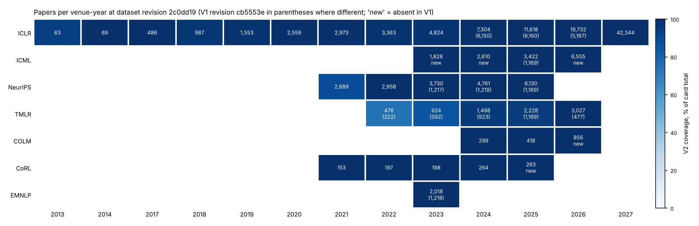

# V2 corpus inventory (Gate 0)

_2026-10-15, Agent A (thread "V2 corpus discovery and provenance"). Every number here comes from a table
in `results/v2/inventory/`, produced by the scripts in `scripts/v2/` (commands at the end). No paper text
is stored in the repository._

## Summary

- **New pin: `2c0dd192a3d3ba6605ed3f5ed5df145dddbdcb27`** (dataset commit of 2026-10-15 06:59 UTC, the
  head at the time of writing; nothing has been pushed since). V1 stays pinned at
  `cb5553e0c192c31c562a2822668c7f4ebbb9437a` (`mlngrams.load.V1_REVISION`, still the default `REVISION`).
- Between the two revisions there are **61 dataset commits, every one titled "add N papers"**
  (`dataset_commits_since_v1.txt`). The corpus grew from 93,249 to **145,377 records (+52,128)**.
- **Nothing in V1 changed.** All 93,249 V1 records are present in V2 under the same `paper_id`, the same
  `pdf_sha256` and the same `text_sha256` in all three configs (`omissions`, `clean`, `direct`).
  No record was removed, re-extracted, replaced by another PDF version or moved to another venue-year
  (`record_changes.csv`). 55 of the 95 parquet files are byte-identical (same git blob). The other 40 files
  only gained rows. On two changed files I compared the texts directly as well as their hashes: they are
  identical, and `text_sha256` = SHA-256 of the UTF-8 text in every row.
- **Every V1 result can therefore be reproduced exactly on V2 by restricting to V1 records**
  (`membership.csv.gz`). Any V1/V2 difference comes from the added records alone. Cleanup and extraction
  changes are ruled out, because there are none.
- **What is new:**
  - ICLR 2024–2026 are now essentially complete (98.6–99.6%, up from 83/53/26%).
  - ICML 2023, 2024 and 2026 are new; ICML 2025 is now complete.
  - NeurIPS 2023–2025 and EMNLP 2023 are now complete.
  - TMLR grew in every year and now includes submission versions.
  - COLM 2026 and CoRL 2025 are new.
- **2026-written populations now available outside ICLR 2027:** ICML 2026 (6,555 accepted camera-ready
  papers), COLM 2026 (856 camera-ready papers) and TMLR 2026 (3,027 papers, half of them submissions).
  ICLR 2026 is also complete now; its camera-ready versions (27%) were revised in early 2026.
- **The V1 non-ICLR cross-checks were drawn from accepted papers only.** The V1 samples of NeurIPS, ICML,
  TMLR and EMNLP were id-prefix-truncated crawls (ASCII order) of accepted, camera-ready papers: 99.8–100%
  published (`version_mix_by_status.csv`). V2 adds the remaining accepted papers, plus public
  rejected or under-review submissions: 7–8% of the added NeurIPS records and 58–93% of the added TMLR
  records. **V2 venue cohorts must be stratified by version** before they are compared with V1.
- No mathematics or theoretical-CS venue is in the dataset. Those stay future acquisition targets.
  NeurIPS 2026 is also absent.

## Old/new inventory matrix



Rows of the `omissions` config; `clean` and `direct` have identical row counts in every file. "Card" is
the total of public OpenReview papers on the V2 dataset card (catalogue of 2026-09-24; ICLR 2027:
2026-10-04). V1 coverage is computed against the same card totals, which did not change. Status:
**=** byte-identical file, **+** rows added, **new** = file absent in V1.

| venue | year | V1 rows | V2 rows | card | V1 cov. | V2 cov. | file | published / submission (V2, first page) |
|---|---|---:|---:|---:|---:|---:|---|---|
| ICLR | 2013 | 63 | 63 | 67 | 94.0 | 94.0 | = | (no style header) |
| ICLR | 2014 | 69 | 69 | 69 | 100 | 100 | = | (no style header) |
| ICLR | 2017 | 486 | 486 | 490 | 99.2 | 99.2 | = | 39.9 / 58.6 |
| ICLR | 2018 | 987 | 987 | 1,018 | 97.0 | 97.0 | = | 32.8 / 62.9 |
| ICLR | 2019 | 1,553 | 1,553 | 1,579 | 98.4 | 98.4 | = | 31.0 / 68.3 |
| ICLR | 2020 | 2,559 | 2,559 | 2,594 | 98.7 | 98.7 | = | 25.9 / 72.8 |
| ICLR | 2021 | 2,973 | 2,973 | 3,014 | 98.6 | 98.6 | = | 28.3 / 70.6 |
| ICLR | 2022 | 3,363 | 3,363 | 3,422 | 98.3 | 98.3 | = | 31.0 / 68.1 |
| ICLR | 2023 | 4,824 | 4,824 | 4,955 | 97.4 | 97.4 | = | 30.5 / 68.1 |
| ICLR | 2024 | 6,150 | **7,304** | 7,404 | 83.1 | 98.6 | + | 29.8 / 68.9 |
| ICLR | 2025 | 6,160 | **11,618** | 11,672 | 52.8 | 99.5 | + | 31.9 / 67.9 |
| ICLR | 2026 | 5,167 | **19,732** | 19,814 | 26.1 | 99.6 | + | 27.1 / 72.7 |
| ICLR | 2027 | 42,344 | 42,344 | 42,429 | 99.8 | 99.8 | = | 0.0 / 99.8 |
| ICML | 2023 | 0 | **1,828** | 1,828 | 0 | 100 | new | 99.8 / 0.0 |
| ICML | 2024 | 0 | **2,610** | 2,610 | 0 | 100 | new | 99.8 / 0.0 |
| ICML | 2025 | 1,169 | **3,422** | 3,423 | 34.2 | 100 | + | 95.2 / 4.7 |
| ICML | 2026 | 0 | **6,555** | 6,556 | 0 | 100 | new | 96.5 / 3.3 |
| NeurIPS | 2021 | 2,689 | 2,689 | 3,020 | 89.0 | 89.0 | = | 92.4 / 7.3 |
| NeurIPS | 2022 | 2,958 | 2,958 | 2,987 | 99.0 | 99.0 | = | 94.8 / 5.1 |
| NeurIPS | 2023 | 1,217 | **3,730** | 3,733 | 32.6 | 99.9 | + | 94.7 / 5.3 |
| NeurIPS | 2024 | 1,219 | **4,761** | 4,762 | 25.6 | 100 | + | 94.2 / 5.7 |
| NeurIPS | 2025 | 1,169 | **6,130** | 6,131 | 19.1 | 100 | + | 94.3 / 5.5 |
| TMLR | 2022 | 222 | **476** | 642 | 34.6 | 74.1 | + | 49.6 / 48.3 |
| TMLR | 2023 | 592 | **924** | 1,079 | 54.9 | 85.6 | + | 65.5 / 33.3 |
| TMLR | 2024 | 923 | **1,498** | 1,571 | 58.8 | 95.4 | + | 67.7 / 30.7 |
| TMLR | 2025 | 1,169 | **2,228** | 2,344 | 49.9 | 95.1 | + | 67.6 / 31.4 |
| TMLR | 2026 | 477 | **3,027** | 2,623 | 18.2 | 115.4 | + | 49.8 / 49.3 |
| COLM | 2024 | 299 | 299 | 299 | 100 | 100 | = | 99.7 / 0.0 |
| COLM | 2025 | 418 | 418 | 418 | 100 | 100 | = | 99.0 / 0.0 |
| COLM | 2026 | 0 | **856** | 856 | 0 | 100 | new | 100 / 0.0 |
| CoRL | 2021 | 153 | 153 | 153 | 100 | 100 | = | 100 / 0.0 |
| CoRL | 2022 | 197 | 197 | 197 | 100 | 100 | = | 100 / 0.0 |
| CoRL | 2023 | 198 | 198 | 199 | 99.5 | 99.5 | = | 100 / 0.0 |
| CoRL | 2024 | 264 | 264 | 264 | 100 | 100 | = | 99.2 / 0.0 |
| CoRL | 2025 | 0 | **263** | 263 | 0 | 100 | new | 98.5 / 0.4 |
| EMNLP | 2023 | 1,218 | **2,018** | 2,020 | 60.3 | 99.9 | + | (no header; see below) |
| **total** | | **93,249** | **145,377** | | | | | |

Tables: `matrix.csv` (with per-config file status and card totals of both revisions), `files.csv`
(every file at both revisions with size, git blob id and LFS SHA-256), `version_mix.csv`.

### How "published / submission" was measured

`scripts/v2/version_mix.py` reads the first page of the raw `direct` text and looks for the venue's
running header or first-page footer. A record counts as a **submission** if the first page carries
"under review as/by …", "submitted to the Nth conference on …", "anonymous author(s)" or "paper under
double-blind review". It counts as **published** if it carries one of the camera-ready markers: "published
as a conference paper at ICLR/COLM", "published in Transactions on Machine Learning Research", "Proceedings
of the Nth International Conference on Machine Learning", "Nth Conference on Neural Information Processing
Systems (NeurIPS yyyy)" or "Conference on Robot Learning (CoRL yyyy)". Submission markers are checked
first, because NeurIPS and CoRL submissions name the conference too.

The ICLR shares agree with V1's whole-text header rule (V1 2024: 30.5% published; V2 first page, on
the larger 2024 set: 29.8%). EMNLP 2023 pages have no version header in ACL format, and only 7 of
2,018 records have review line numbers. The EMNLP records are therefore almost certainly camera-ready
versions of accepted papers (2,020 public papers ≈ the accepted main + Findings count), but this is
inferred, not measured. These shares are header-based labels. Nobody hand-audited them; 0.1–4% per year
match no header (`unknown`).

## Provenance findings

1. **Purely additive update.** The 52,128 added records were extracted with the same pipeline as V1:
   `positioned-clean-v2` in every row of both revisions, and the same mix of poppler and per-page OCR
   (1–3% OCR in both retained and added records; `extraction_provenance.csv`). No V1 record was
   re-extracted. The V2 deltas therefore isolate a **population** effect (which papers are included),
   not a measurement effect.
2. **The V1 cache was not stale.** For all 31 V1 venue-years, V1's committed coverage tables match the
   `cb5553e` metadata exactly: row counts, median and 95th-percentile lengths, and mean reference and
   table omissions (`v1_cache_consistency.csv`). The V1 numbers were computed on revision `cb5553e`. And
   because no V1 record changed, the revision-cache collision could not have altered V1 counts on any
   revision up to `2c0dd19`. The collision is still a real defect for future revisions; it is fixed (see
   "Cache fix").
3. **How V1's partial files were drawn, now that the full populations are visible:**

   | V1 file | V1 sample | what it was |
   |---|---|---|
   | ICLR 2024 | 6,150 / 7,304 | All 3,001 ids starting `0–P` plus 3,149 of the 4,303 ids starting `Q–z`. Published share 30.5% vs 25.9% in the added 1,154. |
   | ICLR 2025 | 6,160 / 11,618 | All 4,789 ids starting `0–P`, 1,231 of 6,689 ids starting `Q–z`, and 140 title-slug ids. The V1 finding that the `Q–z` and slug strata over-represent accepted papers is confirmed: published 34.4% in V1 vs 29.1% in the added records. V1's restriction of 2025 to the `0–P` stratum was the right call. |
   | ICLR 2026 | 5,167 / 19,732 | An id-prefix crawl (`0–F`, part of `G`). V1 called it "plausibly random", and the full year confirms it: published 27.3% (V1) vs 27.0% (added), median length 54.4k vs 53.7k characters, same omission profile. |
   | NeurIPS 2023–25, ICML 2025 | 1,169–1,219 each | Ids `0`–`J…M` in ASCII order **among accepted, camera-ready papers only** (V1: 99.9–100% published). They hold 27–36% of each year's published papers. |
   | TMLR 2022–26 | 222–1,169 | Accepted (published) papers only (V1: 99.8–100% published). Added TMLR records are mostly submissions: 91% of the 2022 additions, 59% of the 2026 additions. |
   | EMNLP 2023 | 1,218 / 2,018 | Ids `0`–`c` in ASCII order. Length and omission profile are the same as in the added records. |

   The V1 TMLR sample was also longer than the full TMLR population: median 60–62k characters vs
   50–56k in the added records (`added_vs_retained.csv`). Part of that is version: published TMLR
   papers are longer than submissions.
4. **The 140 ICLR 2025 title-slug records are not duplicates.** Their titles match no OpenReview-id record,
   by exact title or by slug prefix, and neither does their PDF or text hash, even though the year is now
   99.5% complete.
5. **Duplicates in V2** (`duplicates_new.csv`). One PDF appears under two TMLR 2026 forum ids. 10 groups
   share an identical `text_sha256`; V1 found 4 of them. The new groups are identical texts submitted in
   consecutive ICLR years (2025→2026 twice, 2026→2027 once), two more within-year 2027 pairs, and
   placeholder texts (`1`, 17 characters) in ICLR 2025/2026. Exclude them by V1's rules: placeholders,
   texts under 2,000 characters, and exact duplicates.
6. **Labels are clean.** The `conference` and `year` columns equal the filename in every V2 row.
   **Titles** are filled for all 2024+ records and all ICML, NeurIPS 2023+, TMLR, COLM, CoRL 2024+ and
   EMNLP records. They are null for ICLR 2013–2023, NeurIPS 2021–22 and CoRL 2021–23 (≥ 87% null;
   `title_coverage.csv`).
7. **TMLR "year" is not a publication year.** TMLR 2026 holds 3,027 records against a card total of 2,623
   (115%), half of them submissions. TMLR has a rolling deadline, and the dataset's year evidently
   follows something other than acceptance year (perhaps submission or last-revision date). It is not
   documented. Treat TMLR year as approximate, and use the published stratum for longitudinal work.
8. **The venues are not independent populations.** Exact normalized-title matches across venue-years
   (`cross_venue_title_overlap.csv`; titles ≥ 25 characters; a lower bound, since retitled papers are
   missed):

   | pair | shared titles | share of the smaller cohort |
   |---|---:|---:|
   | ICLR 2026 ↔ ICML 2026 | 868 | 13.3% of ICML 2026 |
   | ICLR 2025 ↔ ICML 2025 | 423 | 12.4% of ICML 2025 |
   | ICLR 2026 ↔ TMLR 2026 | 323 | 10.7% of TMLR 2026 |
   | ICLR 2024 ↔ ICML 2024 | 258 | 9.9% of ICML 2024 |
   | ICLR 2026 ↔ ICLR 2027 | 237 | 1.2% of ICLR 2026 (V1 found 55 resubmission pairs) |
   | COLM 2026 ↔ ICLR 2026 | 81 | 9.5% of COLM 2026 |

   About one ICML paper in eight was an ICLR submission of the previous autumn. A "replication in ICML"
   that keeps these papers is partly a re-measurement of the same manuscripts. They also make a
   **paired resource**: the same paper as an ICLR 2026 submission (written by September 2025) and as an
   ICML 2026 camera-ready (revised January–June 2026).
9. **Format differences across venues.** ICML and EMNLP are two-column formats. Their cleanup flag
   rate is 3–4× ICLR's (mean `flag_count` 42–57 and 77 vs 15–25), and ICML has about twice as many
   display-equation omissions per paper (80–120 vs 42–48). Line-break hyphenation and column joins
   therefore differ by venue. Compare **within-venue trajectories, not cross-venue levels**, unless a
   check shows the tokens of interest are unaffected.

## Coverage limitations that remain

- ICLR 2025 still holds the 140 title-slug records, which are 100% published and from accepted-paper
  listings. Their forum-id counterparts are absent, so 2025 has a small excess of camera-ready
  papers. Excluding the slug stratum is the cleanest fix.
- NeurIPS 2021 is 89% covered and V1 did not look into why. NeurIPS 2026 is absent: its decisions
  fall after the card's 2026-09-24 catalogue date. The latest NeurIPS cohort is therefore 2025
  (written in early 2025).
- TMLR 2022/2023 are 74% and 86% covered, and the TMLR year semantics are undocumented (item 7).
- Public OpenReview populations differ by venue:
  - ICLR: all submissions, so 27–32% are camera-ready and the rest are submissions.
  - ICML, NeurIPS, COLM, CoRL, EMNLP: accepted papers, plus a few opted-in rejections for NeurIPS and
    ICML 2025–26. Almost all are camera-ready.
  - TMLR: accepted and rejected/under-review papers.
  Only ICLR follows the full submitted population.
- ICLR 2027 is unchanged. It is still a submission snapshot of 2026-10-04, and its comparison population
  is still the under-review stratum.

## When the papers were written

The conference year is not the writing year. The approximate timeline below comes from the venues'
usual calendars and the version mix measured above. The dates are inferred, not checked per paper.

| cohort | version in dataset | drafted | final text |
|---|---|---|---|
| ICLR 2026, submissions (73%) | under review | Jul–Sep 2025 | Sep–Nov 2025 (rebuttal revisions) |
| ICLR 2026, camera-ready (27%) | published | Jul–Sep 2025 | ~Feb–Mar 2026 |
| ICML 2026 (96.5% camera-ready) | published | ~Oct 2025–Jan 2026 | ~Jun 2026 |
| COLM 2026 (100% camera-ready) | published | ~Jan–Mar 2026 | ~Aug 2026 |
| TMLR 2026 | half published, half submission | rolling, 2025–2026 | rolling |
| **ICLR 2027 (99.8% submissions)** | under review | **~Jun–Sep 2026** | **Sep 2026** |
| CoRL 2025, NeurIPS 2025 | camera-ready | 2025 | 2025 |

**ICML 2026 and COLM 2026 are the first non-ICLR cohorts whose final text was written in 2026.**
Both are camera-ready versions of accepted papers. Neither is version-matched to ICLR 2027 submissions.

## Recommended comparison cohorts

Cohorts are listed in priority order. "Adequate" means ≥ 95% of the card total for the stratum used and
≥ 250 papers per year. Every cohort should be analysed in its own version stratum.

| # | cohort | years | n (V2) | 2026-written? | adequacy | use for |
|---|---|---|---:|---|---|---|
| C1 | **ICLR, under-review stratum** | 2017–2027 | ~81k (14.3k in 2026, 42.3k in 2027) | 2027 | adequate in every year (2025: drop the slug stratum) | Primary V1 replication; the 2026→2027 break, now on a complete 2026 cohort (~14k vs V1's ~3.7k) |
| C2 | **ICLR, published stratum** | 2017–2026 | ~16k (5.3k in 2026) | the 2026 camera-ready revisions | adequate | Version-matched camera-ready series; 2026 camera-ready vs 2026 submission of the same year |
| C3 | **ICML, published** | 2023–2026 | 1.8k / 2.6k / 3.3k / 6.3k | **yes (2026)** | adequate, complete | **Main independent venue.** Run it with and without the ~13% ICLR-overlap titles |
| C4 | **NeurIPS, published** | 2021–2025 | 2.5k–5.8k per year | no (latest final text 2025) | adequate (2021: 89%) | Continuity control to 2025: did the 2024 rhetorical burst and the function-word decline replicate on complete years? |
| C5 | **COLM, published** | 2024–2026 | 298 / 414 / 856 | **yes (2026)** | complete but small; topic-skewed (language models) | Second 2026-written venue; check findings at its scale; keep it separate, not pooled |
| C6 | **TMLR, published stratum** | 2022–2026 | 236 / 605 / 1,014 / 1,506 / 1,507 | partly | year semantics undocumented; 2022 is small | Journal control; also has a submission stratum (230–1,493 per year) |
| C7 | CoRL | 2021–2025 | 153–264 | no | complete, small | Robotics control; levels and broad trends only |
| C8 | EMNLP 2023 | 2023 | 2,018 | no | complete, single year | Level comparison only |

Paired designs, now possible:

- **P1 — ICLR 2026 → ICML 2026, same paper (868 title pairs).** A submission written by September 2025,
  then a camera-ready finalised in 2026. This is the only within-paper contrast that spans the move from
  2025 to 2026 writing. It has two confounds: the venue (two-column format, page limits) and the editing
  stage (revision after review).
- **P2 — ICLR 2026 → ICLR 2027 resubmissions (237 exact-title pairs vs 55 in V1).** Version-matched
  (both are submissions) and venue-matched. This is the natural enlargement of V1's resubmission test.
- **P3 — ICLR 2026 → TMLR 2026 (323)** and **ICLR 2025 → ICML 2025 (423)**. A 2025 control for P1:
  does an ICLR→ICML revision cycle move wording the same way in a year with no 2027-style break?
- **P4 — V1 records vs added records within ICLR 2024–2026.** Every V1 record is unchanged, so the V1
  estimate on the retained records must reproduce to the last digit. Any V1→V2 difference then splits
  into a sampling term (V1 subset vs full year) and nothing else.

Suggested allocation for the coordinator:

- **Agent B (replication):**
  - First, C1 and C2 with V1 definitions, and P4 as the V1/V2 decomposition.
  - Then C3 and C4, published stratum, as the cross-venue extension. Report NeurIPS and TMLR V1
    estimates against V2 published-only estimates, because V1's samples were published-only.
- **Agent C (function words):**
  - C1 2024–2027: 2027 is unchanged, so only 2024–2026 can move.
  - C3 ICML 2023–2026, with and without the ICLR-overlap titles.
  - P1 and P2 for matched prose; C5 as a small second venue.
- **Agent D (appendices and disclosures):**
  - Appendix: C1 and C2 for ICLR. For other venues, use C3 and C4 only after separating format and
    page-limit policy: ICML is two-column; NeurIPS 2021–22 had supplements as separate files.
  - Disclosures: the ICLR 2027 statements are unchanged, so Lane B/C labels stay valid. Look for
    LLM-use statements in ICML 2026 and COLM 2026 before assuming they exist.
- **Agent E (review):** cache and revision handling (`src/mlngrams/load.py`), the version labels
  (`scripts/v2/version_mix.py`, not hand-audited), and the venue-overlap exclusions.

## Cache fix (also Gate 1)

The V1 loader cached files at `~/.cache/mlngrams/<config>/<venue>-<year>.parquet`, with no revision in
the path. A file cached for one revision was returned for any other (MRE:
`results/independent_function_words/cache_revision_mre.json`). `src/mlngrams/load.fetch` now works
like this:

- It caches at `~/.cache/mlngrams/<40-char commit sha>/<config>/<venue>-<year>.parquet`. Branch names
  such as `main` are resolved to a sha first.
- It verifies every download against the LFS SHA-256 that the Hub API reports for that path at that
  revision, and refuses a mismatch.
- It writes a `.sha256` sidecar. Later reads check the size, and the full hash when
  `MLNGRAMS_VERIFY=1`.
- It never reads the old unkeyed layout.

`tests/test_cache.py` (6 tests, no network) covers:
- two revisions with different bytes, which now get different files;
- the V1 MRE scenario, where a legacy unkeyed file is ignored;
- a hash mismatch, which is rejected;
- tampered and truncated cache entries, which are detected;
- branch-name resolution.

`scripts/recon.py` had its own hand-built cache path, which now goes through `cache_path`. The full suite
passes (53 tests). Note that the CDN `ETag` is **not** the LFS SHA-256, so the verification uses the
API value.

`MLNGRAMS_REVISION` still defaults to the V1 pin, so every V1 script reproduces V1 unchanged. V2 runs
pass `revision=V2_REVISION` or set `MLNGRAMS_REVISION=2c0dd192a3d3ba6605ed3f5ed5df145dddbdcb27`, and
their outputs go under `results/v2/`.

## Reproduce

```bash
python3 -m pip install -r requirements.txt
# per-record metadata of both revisions, no text (~3 min; column-projected HTTP range reads)
python3 scripts/v2/collect_metadata.py --new 2c0dd192a3d3ba6605ed3f5ed5df145dddbdcb27
# first-page version labels for every V2 record (~15 min; streams only the direct text column)
python3 scripts/v2/version_mix.py --revision 2c0dd192a3d3ba6605ed3f5ed5df145dddbdcb27
# matrix, record-level changes, membership, duplicates, profiles
python3 scripts/v2/corpus_diff.py --card-old results/v2/inventory/dataset_card_cb5553e.md \
    --card-new results/v2/inventory/dataset_card_2c0dd19.md
python3 scripts/v2/inventory_extras.py
python3 scripts/v2/plot_inventory.py
```

Intermediates go to `data/v2/` (git-ignored, about 120 MB).
