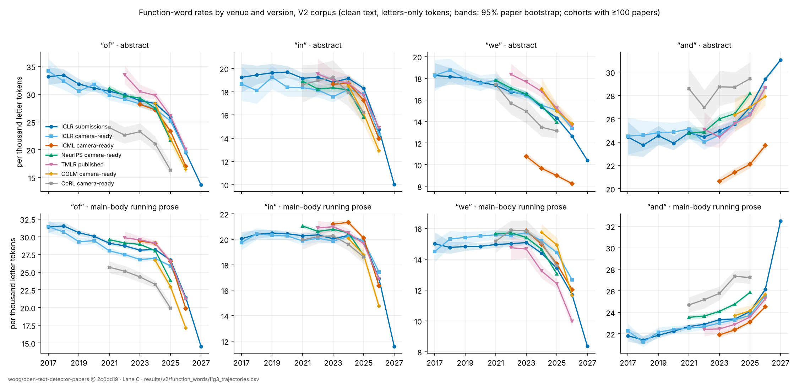
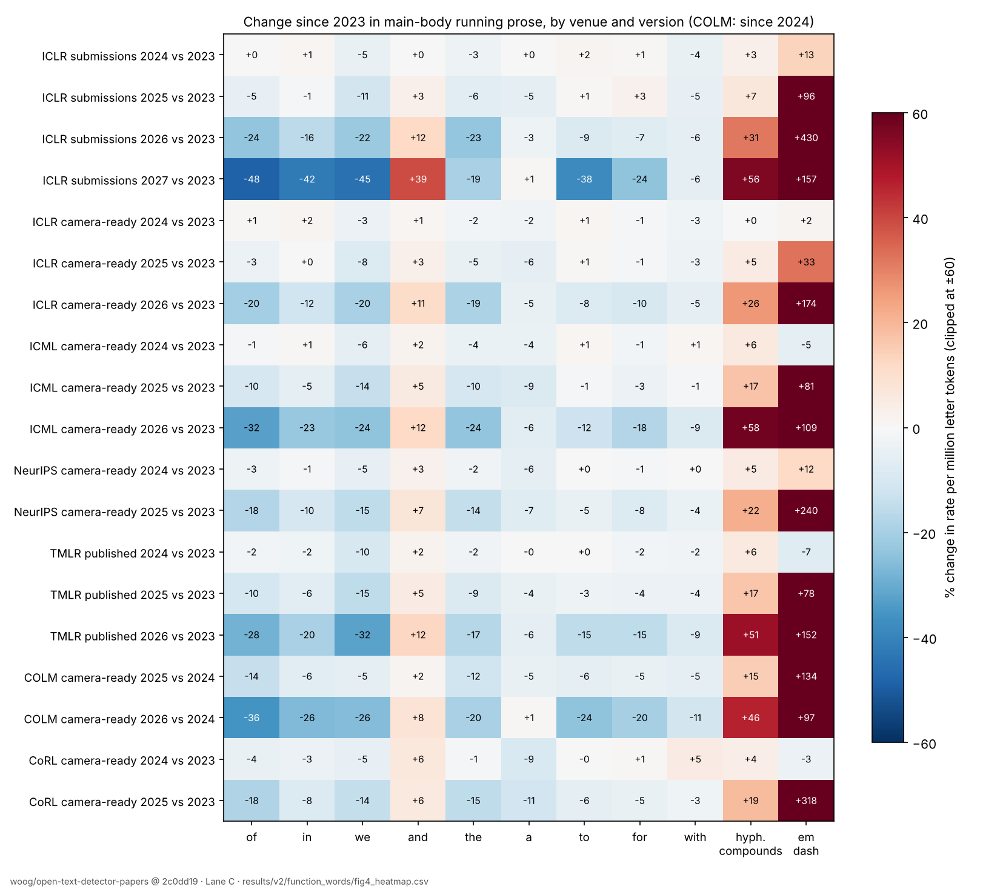
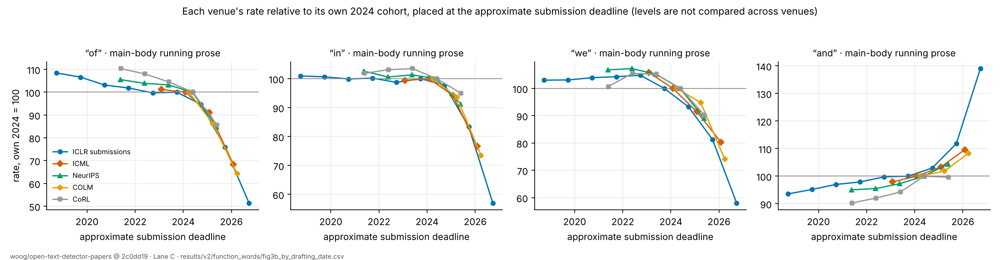

# V2 function words: does the mystery persist, and is it ICLR-only? (Lane C)

_2026-10-15, Agent C (thread "Lane C"). Corpus: `woog/open-text-detector-papers` at
`2c0dd192a3d3ba6605ed3f5ed5df145dddbdcb27` (V2 pin), `clean` config, every record. Tables and figures are
in `results/v2/function_words/`; scripts are `scripts/v2/lane_c_*.py` (commands at the end). No paper
text is stored in the repository. Facts, interpretation and hypotheses are labelled as such._

## Answer

1. **The shift persists on V2, at full size, on a full census.** With a new counter, ICLR submissions'
   main-body running prose has 28,114 "of" per million letter tokens in 2023, 21,431 in 2026 and 14,511
   in 2027 (−48% from 2023; V1 −48% from 2024). "in" −42%, "we" −45%, "and" +39%. Abstracts and the
   first 600 introduction tokens move the same way (abstract "of" −52% from 2024 to 2027).
2. **The V2 additions change nothing.** The 52k added ICLR 2024–2026 papers have the same rates as the
   V1 records of the same year, to within 1–2% (2026 prose "of": V1 records 21,385, added 21,399). V1's
   partial samples were representative for these words. Because no V1 record changed (Gate 0), there
   is no re-extraction term to separate.
3. **It is not ICLR-only. Every venue shows the 2024–2026 decline, timed by when papers were written.**
   Prose "of", change since 2023: ICML camera-ready 2026 −32%, TMLR published 2026 −28%, COLM 2026 −36%
   (since 2024), NeurIPS 2025 −18%, CoRL 2025 −18%, ICLR 2026 submissions −24%. Placed at each cohort's
   approximate submission deadline, the venues fall on top of each other (figure 3b). Every venue's
   per-paper distribution shifts as a whole: 46% of ICML 2026 papers and 80% of ICLR 2027 papers fall
   below the 5th percentile of ICLR 2023.
4. **The ICLR 2027 step has no direct non-ICLR test, but its markers are already moving in 2026.** No
   other cohort was drafted in mid-2026 (COLM 2026, around March, is the latest). ICLR 2027 differs in
   kind from the earlier decline ("the", "to", "and" and the em dash change direction or jump), and
   those same markers shift in 2026-drafted ICML, COLM and TMLR cohorts, more so the later the deadline
   (§5, within-2026 gradient).
5. **Within the same paper, the rates are set when the paper is drafted, not when it is polished.**
   868 papers appear as an ICLR 2026 submission (drafted by September 2025) and an ICML 2026 camera-ready
   (finalised mid-2026); with Lane E's text matches, 1,047 pairs. Their main-body prose keeps its "of"
   rate: −0.5% [−1.2, +0.3] (ICML cohort vs ICLR 2026 cohort: −7%). Resubmissions to ICLR 2027 move
   −10% [−12, −8], concentrated in papers whose abstracts were rewritten (−20%) rather than lightly
   edited (−4%).
6. **It is not an extraction artifact, at least in abstracts.** For papers also posted on arXiv, the
   abstract the authors typed into arXiv's metadata form, which never passes through a PDF text layer,
   shows the same collapse: arXiv-abstract "of" 24,262 per million for ICLR 2024 papers, 20,996 for 2026
   and 12,587 for 2027 (dataset abstracts of the same papers: 25,933 / 20,885 / 12,270). Where the two
   abstracts are worded near-identically, their rates agree within 2%.

Nothing here identifies a cause. In particular these are linguistic correlations; they say nothing
about who or what wrote the text.

## 1. Method (independent of the shared pipeline)

- **Counter** (`scripts/v2/lane_c_count.py`). Does not import `mlngrams`. Tokens are maximal runs of
  ASCII letters, lowercased (`[A-Za-z]+`), so digits, review line numbers, table values and maths symbols
  never enter the denominator. Rates are pooled occurrences per million letter tokens. The V1 headline
  used the `omissions` main body and a different tokenizer, so levels differ; relative changes compare.
- **Regions** (line-anchored headings in the clean text; a region that is not found is missing):
  `abstract` (between an Abstract heading and the introduction heading, 300–6,000 characters),
  `intro600` (the first 600 tokens after the introduction heading, so no section-2 boundary is needed),
  `body` (introduction to references), `prose` (body lines with ≥ 12 tokens and ≥ 85% letters: drops
  tables, equations and headings) and `all`. Body and intro600 were found for ≥ 98.6% of papers in
  every venue-year from 2017 on; abstracts for ≥ 95% except ICML (82–90%, two-column title blocks)
  and EMNLP (94%) (`region_coverage.csv`).
- **Downloader** (`scripts/v2/lane_c_fetch.py`). huggingface_hub's blob cache at the pinned sha, each
  file then checked against the LFS SHA-256 recorded by Gate 0 (`results/v2/inventory/files.csv`).
  All 36 `clean` files passed (Lane E found silent download corruption in this environment, D1).
- **Exclusions** (V1 rules): texts under 2,000 characters, exact duplicate text hashes (first id
  kept), the ICLR 2025 title-slug stratum. **Version** labels are Gate 0's first-page header rule
  (`scripts/v2/version_mix.py`); I re-ran it and reproduced `version_mix.csv` byte for byte.
- **Uncertainty**: 95% percentile intervals from 400 Poisson-weighted paper bootstraps (pairs: 1,000
  multinomial pair bootstraps). They cover sampling of papers only, not extraction or coverage.
- **Statements in the body.** ICLR 2027 papers carry ethics, reproducibility and AI-use statements
  before the references, and my body region keeps them. Cutting the body at the first statement
  heading moves 2027 prose "of" by −1.4% and "and" by −4% (`statement_sensitivity.csv`, a seeded sample
  of 6k papers per year). The abstract and intro600 regions contain no statements and show the full
  shift.

## 2. ICLR recount and the V1/V2 decomposition

`results/v2/function_words/rates_by_cohort.csv` (every venue × year × version × region),
`iclr_v1_vs_added.csv`.

| ICLR submissions, change 2024 → 2027 | of | in | we | and |
|---|---:|---:|---:|---:|
| abstract | −52% | −48% | −32% | +22% |
| intro600 | −52% | −47% | −18% | +24% |
| main-body prose | −48% | −43% | −42% | +39% |
| whole text | −43% | −39% | −54% | +21% |
| _V1 published (omissions main body, own tokenizer)_ | _−48%_ | _−44%_ | _−44%_ | _+36%_ |

| ICLR prose "of" per million | V1 records | added in V2 | all |
|---|---:|---:|---:|
| 2024 | 27,815 (n 6,076) | 27,789 (n 1,146) | 27,811 |
| 2025 | 26,401 (n 5,962) | 26,485 (n 5,399) | 26,441 |
| 2026 | 21,385 (n 5,123) | 21,399 (n 14,426) | 21,395 |
| 2027 | 14,512 (all records are V1) | – | 14,512 |

The camera-ready (published) stratum of ICLR moves with the submissions: prose "of" 26,793 (2023) →
21,309 (2026). The decline is not a version mix.

## 3. Outside ICLR



_Figure 3 (visualization 3). Pooled rates per thousand letter tokens; bands are 95% paper bootstraps;
cohorts with ≥ 100 papers. Data: `fig3_trajectories.csv`._

- **Within-venue trajectories agree in direction and timing.** Levels differ by venue (CoRL is lower in
  "of"; ICML abstracts have far fewer "we", which §7 shows is an extraction-region artifact: arXiv
  abstracts of the same ICML papers have normal "we" rates), so only trajectories are compared, as
  Gate 0 advised.
- **ICML is the main independent venue.** ICML camera-ready prose "of": 29,413 (2023), 29,069 (2024),
  26,508 (2025), 19,860 (2026). Removing the 833 papers whose title also appears at ICLR changes 2026 to
  19,578 (`nonclr_overlap_sensitivity.csv`; the 1,022 excluded papers are the union of exact-title
  matches and Lane E's text matches, `docs/v2-adversarial-review.md` D3). The ICLR-overlap papers
  themselves sit higher (21,273), as expected if they were drafted earlier, for the ICLR deadline.
- **TMLR** moves in both strata: published prose "of" 29,568 (2023) → 21,229 (2026), submissions
  30,388 → 19,108. TMLR's year field is still unresolved (Gate 0 item 7), so its timing is provisional.
- **COLM** (camera-ready, drafted around March 2026) falls furthest among non-ICLR cohorts: 26,654 (2024)
  → 17,098 (2026).
- **NeurIPS 2025 and CoRL 2025** (drafted spring 2025) already show −18%.
- **EMNLP 2023** is one year (prose "of" 27,924) and places a level only.



_Figure 4 (visualization 4). Percent change in main-body running prose relative to each cohort's 2023
rate (COLM: 2024). Data: `fig4_heatmap.csv`._

**By drafting date.** Figure 3b places each cohort at its venue's approximate submission deadline
(ICLR Y: late September Y−1; ICML Y: late January; COLM: late March; CoRL and NeurIPS: spring). These
dates come from the usual calendars and are not checked per paper. On this axis the venues trace one
decline that starts in 2024 and steepens through 2025–2026, and ICLR 2027 continues it.



**Interpretation (tentative).** A cause specific to ICLR (reviewing guidance, its submission system,
its population) cannot produce the 2024–2026 decline, because accepted-paper populations at five other
venues show it at the same time. A cause tied to writing date fits the timing across venues. The
same extraction pipeline produced every venue's text, so cross-venue agreement alone does not rule out
an extraction effect that depends on how recent PDFs are built; the arXiv check addresses that.

## 4. Per-paper distributions

`per_paper_quantiles.csv` (5th–95th percentiles per venue-year-version-region and word).

ICLR submissions, prose "of" per million: median 27,706 (2023), 20,818 (2026), 13,105 (2027); 5th
percentile 18,528 → 11,799 → 6,318; 95th 39,848 → 32,184 → 25,221. The histograms stay unimodal in
every venue and year: the whole distribution moves, with no sign of a separate subpopulation of
extreme papers. Share of papers below ICLR 2023's 5th percentile: ICLR 2026 35%, ICML 2026 46%,
TMLR 2026 published 34%, COLM 2026 67%, ICLR 2027 80%. Papers with no "of" at all in their main body
are still essentially absent (0.05% in 2027).

## 5. Constructions

Main-body running prose, per million letter tokens (from `rates_by_cohort.csv`):

| ICLR submissions | 2019 | 2023 | 2025 | 2026 | 2027 |
|---|---:|---:|---:|---:|---:|
| "the X of" (e.g. *the performance of*) | 9,808 | 9,441 | 9,368 | 6,648 | 3,551 |
| "of the" | 8,295 | 7,039 | 6,092 | 4,369 | 3,381 |
| hyphenated compounds (*target-domain*) | 15,960 | 20,324 | 21,672 | 26,715 | 31,683 |
| possessive 's | 1,014 | 1,050 | 1,819 | 1,912 | 2,179 |
| ", and" | 3,981 | 4,133 | 4,403 | 5,410 | 8,938 |
| "to" | 24,742 | 23,408 | 23,625 | 21,361 | 14,475 |
| "the" | 70,439 | 68,538 | 64,320 | 52,715 | 55,206 |
| em dash | 170 | 141 | 276 | 745 | 361 |
| passive *be + -ed* | 10,641 | 9,607 | 8,735 | 8,224 | 7,616 |
| tokens per sentence | 24.4 | 24.2 | 24.3 | 24.1 | 22.0 |
| mean token length (letters) | 4.97 | 5.02 | 5.20 | 5.39 | 5.39 |

ICML camera-ready moves the same way up to 2026: "the X of" 9,665 → 5,634 (2023 → 2026), hyphenated
compounds 18,833 → 29,699, em dash 246 → 514.

**Facts.** The "of" decline is concentrated in the *the X of Y* construction (−62% since 2023 in ICLR
submissions), while hyphenated compound modifiers rise by about half and possessives double. This is
the pattern of post-modifying *of*-phrases being replaced by pre-modifying compounds (*the performance
of SSL on the target domain* → *target-domain SSL performance*). Read in the text, 2027 low-"of"
abstracts are fluent prose dense with compound modifiers, not garbled or truncated text.

**The 2027 step differs from 2024–2026.** Up to 2026, "the", "to" and "and" change modestly and the em
dash rises in every venue. In ICLR 2027, "to" falls a further 32% in one year, ", and" rises 65%,
sentences shorten by two tokens, "the" rises slightly and the em dash halves. The 2027 cohort is not
simply further along the 2024–2026 trajectory.

### Within-2026 writing-date gradient (added after Lane B's Gate 2)

Does the 2027 step have the same calendar shape as Lane B's rhetorical shift? Each cohort is compared with
its own venue's previous year (prose, `within_2026_gradient.csv`), ordered by approximate deadline:

| cohort (deadline) | n | "of" | "to" | "the" | ", and" | em dash | tokens/sentence |
|---|---:|---:|---:|---:|---:|---:|---:|
| ICLR 2026 submissions vs 2025 (Sep 2025) | 14,201 | −20% | −10% | −18% | +23% | +170% | −1% |
| ICML 2026 vs 2025 (Jan 2026) | 6,276 | −25% | −11% | −15% | +15% | +16% | −2% |
| COLM 2026 vs 2025 (Mar 2026) | 855 | −26% | −20% | −9% | +33% | −16% | −2% |
| TMLR 2026 submissions vs 2025 (rolling) | 1,469 | −25% | −23% | −6% | +48% | +55% | −0% |
| ICLR 2027 vs 2026 (Sep 2026) | 42,025 | −32% | −32% | +5% | +65% | −52% | −9% |

**Facts.** The markers that set ICLR 2027 apart are already moving in 2026-drafted cohorts, more so the
later the deadline: the fall in "to" deepens (−10% → −11% → −20% → −32%), the fall in "the" shrinks and
then reverses (−18% → −15% → −9% → +5%), the em dash's rise turns into a fall (+170% → +16% → −16% →
−52%), and ", and" grows fastest in the latest cohorts. Sentence shortening does not show this gradient
and appears only in ICLR 2027.

**Caveats.** Each row uses its own venue's previous year as baseline, and those baselines were drafted at
different times; ICML and COLM are camera-ready versions finalised months after their deadlines; TMLR
dates are rolling and its year field is unresolved; COLM is small. Four non-ICLR points do not make a
time series. **Interpretation (tentative):** the 2027 function-word step looks like the continuation of a
change that was already under way through 2026 at other venues, with the same calendar shape Lane B
reports for rhetorical phrases, rather than something specific to ICLR 2027.

## 6. Same-paper pairs

`pairs_summary.csv`, `pairs_by_similarity.csv`, `pairs.csv.gz` (ids, versions and abstract similarity
only). Pairs are exact normalized-title matches (≥ 25 characters, titles unique in both cohorts) plus
Lane E's text-matched pairs under different titles (`results/v2/review/e4_textpairs_*.csv`, D3), where
Lane E computed them (all designs below except the 2024→2025 and 2025→2026 resubmissions and
ICLR 2025 → TMLR 2025).
"Similarity" is the difflib ratio between the two abstracts' word sequences. It is a rough revision
measure; ICML's two-column layout sometimes interleaves introduction text into the abstract region,
which lowers it.

| design | pairs (prose) | "of" in A | "of" in B | pair change | cohort change |
|---|---:|---:|---:|---:|---:|
| ICLR 2026 → ICML 2026 | 1,047 | 21,388 | 21,287 | −0.5% [−1.2, +0.3] | −7.1% |
| ICLR 2025 → ICML 2025 | 531 | 27,145 | 27,003 | −0.5% [−1.3, +0.2] | +0.3% |
| ICLR 2024 → ICML 2024 | 330 | 27,881 | 28,501 | +2.2% [+1.3, +3.2] | +4.5% |
| ICLR 2026 → ICLR 2027 | 295 | 23,030 | 20,659 | −10.3% [−12.3, −8.2] | −32.2% |
| ICLR 2025 → ICLR 2026 | 150 | 27,047 | 24,347 | −10.0% [−12.6, −7.5] | −19.1% |
| ICLR 2024 → ICLR 2025 | 72 | 27,263 | 26,557 | −2.6% [−5.1, +0.1] | −4.9% |
| ICLR 2026 → TMLR 2026 | 411 | 22,698 | 21,427 | −5.6% [−6.8, −4.5] | −5.8% |
| ICLR 2026 → COLM 2026 | 93 | 21,340 | 19,526 | −8.5% [−10.7, −6.1] | −20.1% |

- **ICLR → ICML: revision for a 2026 camera-ready leaves the prose rates where they were.** The same
  holds for "in", "we" and "and" (+0.6%, −2.2%, −0.1%), and in the two earlier years. The abstracts are
  heavily edited (median similarity 0.47) and their "of" falls about 8% in every year, 2024 included,
  so that abstract change belongs to the ICLR→ICML revision cycle, not to 2026.
- **Resubmissions move in proportion to how much they were rewritten.** ICLR 2026 → 2027 prose "of":
  −20% for pairs with abstract similarity below 0.5 (n 100), −7% for 0.5–0.95 (n 131), −4% at ≥ 0.95
  (n 64). The 2025 → 2026 control pairs show the same gradient (−19%, −11%/−6%, −3%). Rewritten papers take on the newer
  cohort's rates; lightly edited papers keep their old ones.
- **Interpretation (tentative).** The function-word profile behaves like a property of the drafting
  of a text: it changes when text is (re)drafted, not when a finished paper is revised, re-typeset or
  moved to another venue's template. Re-typesetting from ICLR's one-column to ICML's two-column format
  changes the extraction (Gate 0 item 9) but not these rates, which also argues against a
  layout-dependent extraction artifact.

## 7. arXiv abstracts (extraction-independent check)

`scripts/v2/lane_c_arxiv.py`, `lane_c_arxiv_summary.py`; `arxiv_abstracts.csv` (ids, dates, similarity and
counts only) and `arxiv_summary.csv`.

**Design.** A seeded sample of 120 papers per cohort (seed `20261015-<cohort>`, papers with a title of
≥ 20 characters). Each title is searched on the arXiv API and kept only on an exact normalized-title
match. The arXiv abstract is metadata the authors type in when posting; it is not extracted from a PDF.
It is the latest arXiv version's abstract, so it can differ from the dataset's PDF version; the
word-sequence similarity of the two abstracts is recorded for each pair. This is a version comparison,
not a hash-matched one.

| ICLR cohort | matched | median arXiv v1 date | similarity (median) | "of": dataset | "of": arXiv [95% CI] | "in": dataset / arXiv | "we": dataset / arXiv | "and": dataset / arXiv |
|---|---:|---|---:|---:|---:|---|---|---|
| 2024 | 54 | 2023-10-16 | 0.96 | 25,933 | 24,262 [21,055, 27,516] | 17,200 / 17,679 | 14,642 / 15,234 | 28,050 / 27,365 |
| 2025 | 57 | 2024-10-13 | 0.97 | 26,456 | 25,803 [23,082, 28,435] | 17,860 / 17,924 | 15,774 / 16,538 | 26,874 / 27,102 |
| 2026 | 55 | 2025-10-02 | 0.97 | 20,885 | 20,996 [17,938, 24,170] | 16,653 / 14,782 | 12,789 / 12,805 | 27,693 / 28,999 |
| 2027 | 32 | 2026-09-25 | 0.97 | 12,270 | 12,587 [10,176, 15,023] | 8,784 / 10,312 | 11,573 / 12,436 | 28,723 / 28,207 |

Outside ICLR (same design):

| cohort | matched | median arXiv v1 date | similarity (median) | "of": dataset | "of": arXiv [95% CI] | "we": dataset / arXiv |
|---|---:|---|---:|---:|---:|---|
| ICML 2023 | 84 | 2023-02-27 | 0.53 | 30,215 | 32,289 [29,164, 35,526] | 11,689 / 18,904 |
| ICML 2026 | 71 | 2026-02-16 | 0.54 | 16,932 | 16,437 [14,112, 18,847] | 9,309 / 15,628 |
| COLM 2026 | 96 | 2026-04-06 | 0.97 | 16,796 | 17,374 [15,258, 19,367] | 12,856 / 13,531 |

ICML arXiv abstracts fall from 32,289 to 16,437 (−49%) between papers posted in early 2023 and early 2026.
COLM 2026 agrees with the dataset as closely as ICLR does. The low ICML similarity confirms that the
extracted ICML abstract region is often not the abstract (C-N2 in `docs/v2-negative-results.md`); the
arXiv abstracts give ICML a normal "we" rate, so ICML's low abstract "we" in the dataset is a region
artifact, not a venue style.

Restricting to pairs with similarity ≥ 0.9 (37 / 43 / 43 / 23 papers), "of" is 24,172 vs 24,181 (2024),
21,119 vs 21,339 (2026) and 12,656 vs 12,595 (2027).

**Facts.** The abstracts authors posted to arXiv carry the same low function-word rates as the dataset's
extracted abstracts, year by year, and the decline appears in ICML's and COLM's arXiv abstracts too. The arXiv-posted 2027 papers are a minority (32 of 120 sampled) and
were posted around the ICLR deadline.

**Interpretation.** In abstracts, the decline is in the text the authors wrote, not in the dataset's PDF
extraction. This closes the extraction explanation (H2 of the V1 investigation) for abstracts. Main-body
prose was not checked against an extraction-independent source; its decline matches the abstracts'
in size and timing, and it survives re-typesetting into ICML's format (§6). Two limits: arXiv posting
is selective, and the arXiv abstract is a different version.


## 8. Hypotheses after V2

| Hypothesis | V2 evidence | Status |
|---|---|---|
| Counting or preprocessing error in the shared pipeline | New counter, full census, letters-only denominator: same size of shift | Rejected as the explanation |
| Composition: V1's partial ICLR 2024–2026 samples | Added papers have the V1 records' rates | Rejected for V1→V2; nothing changes |
| Something specific to ICLR (guidance, OpenReview, population) | ICML, TMLR, COLM, NeurIPS, CoRL show the 2024–2026 decline in step | Rejected for 2024–2026; untestable for the 2027 step |
| Version mix (submission vs camera-ready) | Both ICLR strata and both TMLR strata decline; camera-ready revision leaves paired prose unchanged | Rejected |
| Statements and boilerplate | Abstracts and intro600 show the full shift; cutting statements moves 2027 prose by 1% | Rejected |
| Extraction artifact tied to recent PDFs | arXiv metadata abstracts (no PDF) show the same rates; same-paper rates survive re-typesetting into ICML format | Rejected for abstracts; body prose not checked against sources |
| A change in how text is drafted, from 2024 on, across ML venues | Timing by drafting date across venues; the *the X of* → compound shift; rates change only when text is rewritten | Consistent with everything here; cause not identified |

What would separate the remaining explanations: (a) LaTeX sources (arXiv e-prints are reachable from
this environment; OpenReview is not) for body prose; (b) a
non-ICLR cohort drafted in mid-2026 (NeurIPS 2026 when released) for the 2027 step; (c) a corpus
outside ML, or outside this dataset, to see whether the change is field-specific.

## Reproduce

```bash
python3 -m pip install -r requirements.txt
python3 scripts/v2/version_mix.py --revision 2c0dd192a3d3ba6605ed3f5ed5df145dddbdcb27   # Gate 0 labels, ~15 min
python3 scripts/v2/lane_c_fetch.py --config clean      # 4.4 GB, hash-checked
python3 scripts/v2/lane_c_count.py                     # per-paper counts -> data/v2/lane_c/counts (~40 min, 4 cores)
python3 scripts/v2/lane_c_analyze.py                   # cohort tables
python3 scripts/v2/lane_c_pairs.py                     # same-paper pairs
python3 scripts/v2/lane_c_figures.py                   # figures 3, 3b, 4
python3 scripts/v2/lane_c_statement_check.py           # statement sensitivity
python3 scripts/v2/lane_c_arxiv.py --n 120             # arXiv abstracts (~1 h; arXiv rate-limits)
```
