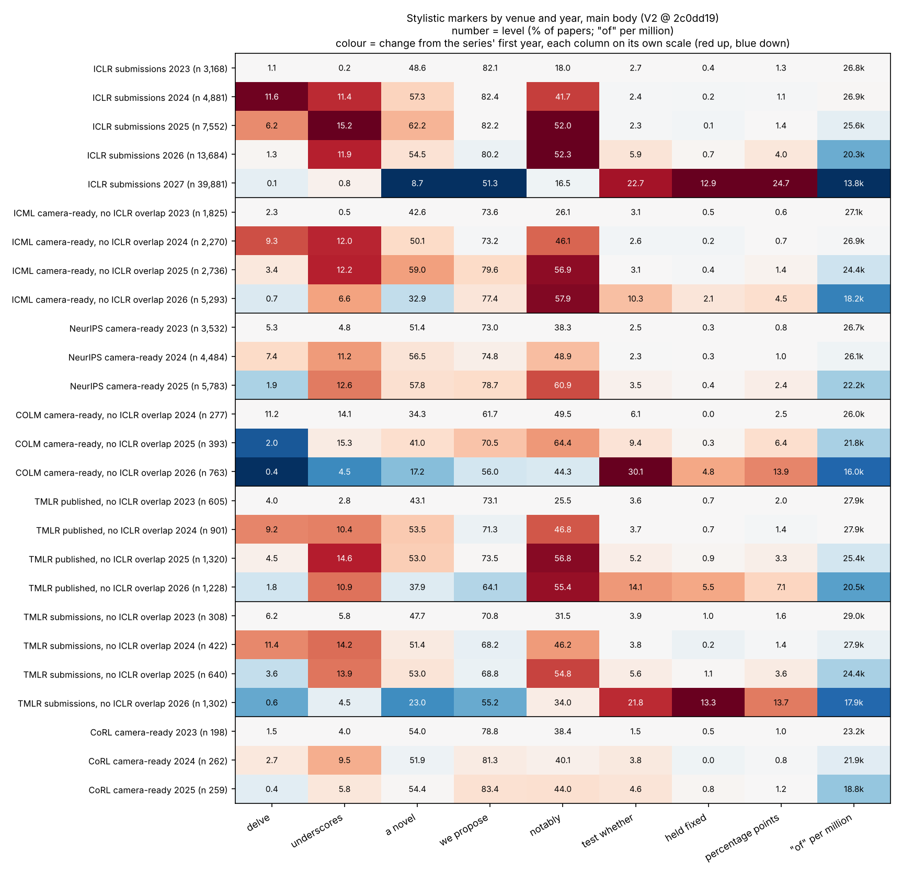

# V2 integration: expanded corpus, independent replication (Gate 5)

_2026-10-16, draft 2. Integrates Gate 0/1 (Lane A: `docs/v2-corpus-inventory.md`, `docs/v2-corpus-diff.md`),
Lane B (`docs/v2-replication.md`), Lane C (`docs/v2-function-words.md`), Lane D
(`docs/v2-appendices-disclosures.md`) and Lane E (`docs/v2-adversarial-review.md`). Dataset
`woog/open-text-detector-papers`, V2 pin `2c0dd192a3d3ba6605ed3f5ed5df145dddbdcb27`; V1 pin
`cb5553e0c192c31c562a2822668c7f4ebbb9437a` stays the default and reproduces. No number here is new
unless it cites `results/v2/integration/`; every other figure is a lane's, with the lane named.
**Fact**, **interpretation** and **hypothesis** are labelled where the difference matters. Nothing
here is evidence about who or what wrote any text, and no claim about AI authorship or tool adoption
is made from linguistic correlations._

## Status of the inputs

| Gate | Owner | State | Lane E verdict |
|---|---|---|---|
| 0. Corpus discovery | Lane A | done (`e91d134`) | confirmed (E1–E3), minor count fixes |
| 1. Provenance and cache | Lane A | done (`df37fbe`) | confirmed; latent defects D1, D2 found elsewhere |
| 2. Replication | Lane B | done (`713b3db`) | numbers reproduce; D2 fixed, D3 adopted; B1 and B2 fixed (`50f5d19`), no result changed |
| 3. Function words | Lane C | done (`6b80821` … `ac0d4c0`) | numbers reproduce (E5, E6); D3 adopted. Open: C1 figure 3b compares levels across venues, C2 TMLR year text |
| 3–4. Appendices, disclosures | Lane D | done (`90f33b5`) | 7% → 47% and ICLR 2026 statement rate reproduce with Lane E code (E9). Open: D-1 D3 not applied (ICML step and pairs are title-only); category shares **provisional** until Bobby's 45 labels are scored |
| 5. Integration | this document | draft 2: Lane E's second pass (`ee1cb5f`) folded in | no result-changing defect found in B, C or D; fixes C1, C2, B1, B2, D-1 routed to their lanes and open until their docs show them |

Every directive figure exists, each with its table and revision:

1. corpus expansion matrix: `results/v2/inventory/fig_corpus_expansion.png`;
2. old/new stability: `results/v2/replication/figures/fig_v2_2_stability.png`;
3. function-word trajectories: `results/v2/function_words/fig3_trajectories.png`, `fig3b_by_drafting_date.png`;
4. cross-venue heatmaps: function words `results/v2/function_words/fig4_heatmap.png`; stylistic markers
   `results/v2/integration/fig4c_marker_heatmap.png` (new here, below);
5. appendix decomposition: `results/v2/appendices/figures/fig5_appendix_decomposition.png`;
6. vocabulary rise and reversal: `results/v2/replication/figures/fig_v2_6_vocab_rise_reversal.png`;
7. revision waterfall: `results/v2/replication/figures/fig_v2_7_revision_waterfall.png`.

## The seven questions

### 1. What did woog add or change?

**Woog only added papers.** Between the two pins there are 61 dataset commits, each titled "add N
papers". The corpus grew from 93,249 to 145,377 records (+52,128). No record was removed,
re-extracted, given a different PDF or moved to another venue-year, and the extraction pipeline
(`positioned-clean-v2`, same poppler/OCR mix) is unchanged. Lane E confirmed this by hashing every
text itself in all three configs (E1).

What the additions are:
- **ICLR 2024–2026 are now essentially complete** (98.6–99.6%, from 83 / 53 / 26%). ICLR 2027 is
  byte-identical.
- **New or completed venue-years:** ICML 2023, 2024, 2026 (new) and 2025 (completed); NeurIPS 2023–25
  and EMNLP 2023 (completed); COLM 2026 and CoRL 2025 (new); TMLR grew in every year.
- **The first non-ICLR cohorts written in 2026:** ICML 2026 (6,555), COLM 2026 (856), TMLR 2026
  (3,027, half submissions).
- **Not added:** NeurIPS 2026, and any mathematics or theoretical-CS venue. Those stay future
  acquisition targets.

Three facts change how the new data may be used:
- **V1's non-ICLR samples were accepted, camera-ready papers only.** V2 adds public submissions
  (TMLR about half its additions, NeurIPS and ICML about 5%). Pooling versions manufactures a TMLR
  "change", so every venue is analysed in its own version stratum.
- **The venues are not independent.** At least 16.3% of ICML 2026 papers are ICLR 2026 manuscripts
  (title or text match; titles alone said 13.3%; Lane E D3). They also share one extraction pipeline.
- **Downloads in this environment can be silently corrupted** (10 of about 157 whole-file downloads
  failed the LFS hash with no HTTP error; E-N1). Only hash-verified downloads were used for results.
  The revision-cache collision the directive named is fixed: the cache is keyed by commit sha and
  verified against the Hub's LFS hash (`tests/test_cache.py`).

Because nothing in V1 changed, **every V1/V2 difference comes from the added records**. The "modified
text" term of the revision waterfall is zero by measurement, not by assumption (Lane B,
`exactness_v1repro.csv`).

### 2. Which old results survived?

All the per-year results did. This needs one caveat up front: the V1 records are a subset of V2 and
ICLR 2027 is unchanged, so "survives" mostly means **V1's partial 2024–2026 samples were
representative**. The independent tests are the other venues (question 5) and the separately written
counters of Lanes C and E.

| V1 / V1.5 result | V2 estimate | source |
|---|---|---|
| Per-year findings §1–§5 (2024 burst and fade, 2027 break, function words, stopword share, "across") | 75 of 75 effects within the pre-registered ±25%; e.g. *delve* 2024 10.8% (V1 10.7%), *a novel* 2026→27 −44.7 pp (V1 −44.9) | Lane B |
| Top-riser and top-faller rankings | Spearman 0.86 / 0.88, no sign flips, all of V1's top 25 in V2's top 100 | Lane B |
| Main-body vs all-text sensitivity | Spearman 0.80 / 0.88 / 0.99 (V1 0.78 / 0.87 / 0.99) | Lane B |
| ICLR function-word shift 2024→2027: of −48%, in −43%, we −44%, and +41% | −47.6 / −42.6 / −41.8 / +39.4% (Lane E counter); prose −48 / −43 / −42 / +39% (Lane C counter) | Lanes C, E |
| Added papers carry the same rates as V1's records | within 1–2.4% per word and year | Lanes B, C, E |
| Appendix share 7% → 47% (median raw post-reference share, 2017 → 2027) | 7.2% → 46.9%; V1.5 tables reproduce 297/297 rows | Lane D |
| Main body flat, appendix grows | ICLR submissions: main 4,449 → 4,289 tokens, appendix 135 → 4,156 | Lane D |
| 2027 disclosure extraction and the V1.5 body contrasts | 41,005 vs 41,006 statements; contrasts within \|d\| 0.012 | Lane D |
| 2024 vocabulary burst and staggered fade outside ICLR | replicates in complete ICML, NeurIPS, COLM and TMLR published cohorts, same word order | Lane B |

### 3. Which results weakened, disappeared or reversed?

**Facts.**
- **V1's pooled, corpus-weighted contrasts were mostly a measurement of ICLR 2027** (Lane B, B-N1).
  ICLR 2027 was 81% of V1's 2025–27 cohort and is 58% of V2's. Corpus-weighted log2 changes move by a
  median 0.51 bits, year-balanced ones by 0.02. Seven pre-registered watchlist verdicts flip: *a
  novel*, *we propose*, *novel approach* and *moreover* go from "down" to "flat"; *delve into*,
  *crucial role* and *plays a crucial* from "flat" to "up". *leverage* reverses (−0.38 → +0.19 bits).
  Pre-registered hits go from 17 to 24 of 36. No year's data changed. **Quote year-balanced contrasts
  or per-year values from now on.**
- **The paper-share riser list is weakened** by the pre-registered rule (Spearman 0.76 < 0.8), for the
  same reweighting reason.
- **"The 2027 break is ICLR-only so far" (V1 handoff) no longer holds.** Its markers move in every
  2026-written cohort outside ICLR (question 5).
- **V1.5's strongest alternative for 2027, the doubled submission cohort, is weakened as a sole
  explanation.** TMLR's published cohort did not grow (1,506 → 1,507) yet shows its largest appendix
  step (+780 median tokens) and the 2027-type register shift (Lanes B, D).
- **The AI-word association with drafting disclosures does not replicate in ICLR 2026**: d_adj −0.024
  (CI −0.102 to 0.049), against −0.079 in 2027. "We propose" and "a novel" do replicate (−0.237,
  −0.111). In 2026 the body-language gradient separates **polish-only papers from all others**;
  drafting vs polish-plus is null on every feature (Lane D). Group labels are provisional.
- **V1.5's clean-statement tier does not transfer to ICLR 2026** (87% of 2026 statements are the last
  section of the paper; D-N1). A V2 tier is reported as a separate sensitivity definition.
- **The directive's MuPDF re-extraction of a 2027 PDF has no record in the repository.** V1's
  independent investigation downloaded zero PDFs (OpenReview returned 403). It is not cited here
  (Lane E D4).

Nothing reversed in any year's data. The two reversals are verdicts on a pooled contrast whose
weighting changed.

### 4. Does the function-word mystery persist?

**Yes, at full size, and it is no longer an ICLR mystery.**

**Facts** (Lanes C and E, two counters written independently of the shared pipeline and of each
other):
- ICLR submissions' main-body prose: "of" 28,114 per million letter tokens (2023), 21,431 (2026),
  14,511 (2027). Abstracts and the first 600 introduction tokens move the same way (abstract "of" −52%
  from 2024).
- The whole per-paper distribution moves. 80% of ICLR 2027 papers fall below ICLR 2023's 5th
  percentile; distributions stay unimodal; papers with no "of" at all are 0.05%.
- **About 40% of the 2024→2027 fall happened between 2025 and 2026**, before ICLR 2027.
- **Abstracts posted to arXiv, which never pass through PDF extraction, carry the same rates** as the
  dataset's abstracts: "of" 24,262 (ICLR 2024 papers) → 12,587 (2027) per million, against 25,933 →
  12,270 in the dataset. Where the two abstracts are near-identical they agree within 2%. ICML's arXiv
  abstracts fall 49% between early 2023 and early 2026.
- **Same-paper rates are set when a text is drafted.** 1,047 papers that went from an ICLR 2026
  submission to an ICML 2026 camera-ready keep their prose "of" rate (−0.5%, CI −1.2 to +0.3), while
  the ICML cohort moved −7%. Resubmissions move in proportion to how much they were rewritten:
  −20% when the abstract was rewritten, −4% when it was lightly edited, in 2026→27 and in the
  2025→26 control alike.
- **What replaces "of"** is restructuring, not deletion: *the X of Y* falls 62% (2023→2027) while
  hyphenated compound modifiers rise about half and possessives double. Read in context, low-"of" 2027
  text is fluent prose dense with compounds. Lane E's test for "of" dropped by extraction ("one the",
  "most the") was a false alarm on reading the matches (E7, E-N2).

**Hypotheses now rejected as the explanation** (Lane C §8): a counting or preprocessing error; V1's
partial samples; something specific to ICLR (for 2024–2026); version mix; statements and boilerplate;
an extraction artifact, **for abstracts**.

**Still open.** (a) Main-body prose has not been checked against an extraction-independent source
(LaTeX). Its decline matches the abstracts' in size and timing and survives re-typesetting into ICML's
format, so an artifact is unlikely, but not excluded. (b) The cause. (c) **ICLR 2027 differs in kind,
not only in degree:** "to" −32% and ", and" +65% in one year, sentences two tokens shorter, "the"
rising slightly and the em dash halving. Some of these markers already move in 2026-drafted cohorts
elsewhere (question 5); sentence shortening does not.

So, to the directive's closing line: half of the "of"s have gone missing from ICLR prose, and a third
to a quarter elsewhere in ML, but what is happening looks like English noun phrases being rebuilt
(*target-domain SSL performance* for *the performance of SSL on the target domain*), not English
losing its prepositions. The linguists may well be interested; outside ML we have not looked
(question 7).

### 5. What do independent venues tell us?

First, how independent they are: they share the dataset's extraction pipeline, overlap with ICLR by
up to a sixth of their papers, are almost all camera-ready versions where ICLR is mostly submissions,
and differ in format (ICML and EMNLP are two-column). **So only within-venue trajectories are
compared, never cross-venue levels**, and ICML is analysed without its ICLR-overlap papers.



_Figure 4c (new; `scripts/v2/integration_marker_heatmap.py`, table `fig4c_marker_heatmap.csv`).
Lane B's main-body estimates, revision `2c0dd19`; ICML, COLM and TMLR rows exclude ICLR-overlap papers. Number = level; colour = change from the series'
first year, each column on its own scale. Read along one venue only. The function-word half of
visualization 4 is Lane C's `fig4_heatmap.png`._

**Facts.**
- **Function words: one decline across ML venues, timed by writing date.** Prose "of" since 2023:
  ICML 2026 −32%, COLM 2026 −36% (since 2024), TMLR published 2026 −28%, NeurIPS 2025 −18%, CoRL 2025
  −18%, ICLR 2026 −24% (Lane C). Lane E's counter agrees on every venue's latest step within one
  point. Placed at each venue's submission deadline, the venues trace parallel declines starting in
  2024 (Lane C figure 3b; that figure plots levels across venues, which are not comparable, so read
  its slopes, not its overlap; Lane E C1, fix routed to Lane C).
- **Within one venue, the decline is smooth by month.** Published TMLR papers, dated by the month
  printed in their header, hold "of" at 27.5–28.1k per million through 2024, then fall in every
  quarter from 2025 Q2: 26.4k, 25.2k, 24.4k, 23.0k, 21.3k, 19.3k, and 17.0k (16.0–18.1k) in October
  2026, with no single step. "and" rises and "we" falls over the same quarters (Lane E,
  `e10_tmlr_by_publication_quarter.csv`). Publication month lags writing by months.
- **The 2027 rhetorical register appears in every 2026-written cohort** (Lane B; % of papers):
  *a novel* ICML 59.0 → 32.9 (2025 → 2026), COLM 41.0 → 17.2, TMLR submissions 53.0 → 23.0;
  *test whether* 3.1 → 10.3, 9.4 → 30.1, 5.6 → 21.8, all with ICLR-overlap papers removed (Lane B,
  corrected after Lane E B2). ICLR 2027 itself: 54.5 → 8.7 and 5.9 → 22.7. Amplitude orders TMLR submissions ≈ COLM > TMLR published > ICML, and NeurIPS 2025
  (written a year earlier) barely moves.
- **The within-2026 gradient** (Lane C): the markers that make ICLR 2027 different move more the later
  a 2026 cohort's deadline. "to" falls −10% (ICLR 2026, Sep 2025) → −11% (ICML, Jan 2026) → −20%
  (COLM, Mar 2026) → −32% (ICLR 2027, Sep 2026); "the" goes −18% → −15% → −9% → +5%; the em dash
  +170% → +16% → −16% → −52%.
- **The appendix step is in every 2026-written cohort**, with the main body flat or falling: ICLR
  submissions 2026 → 27 +1,672 median tokens, ICML 2025 → 26 +710, COLM +975, TMLR published +780,
  against +85 and +124 for ICML's earlier years (Lane D). The ICML figure still includes the ≥ 16% of
  ICML 2026 that are ICLR 2026 manuscripts, and ICLR → ICML revision itself adds about +637 appendix
  tokens, so ICML's step is not yet independent evidence (Lane E D-1, fix routed to Lane D). TMLR's
  step, with an unchanged cohort size, does not have this problem.
- **The 2024 vocabulary burst and fade replicate** in ICML, NeurIPS, COLM and TMLR, with NeurIPS a
  year early on several words, as its earlier calendar predicts (Lane B figure 6).
- **Disclosure practice differs by venue.** Dedicated AI-use statements outside ICLR are a 2026
  phenomenon and a minority: COLM 26.3%, TMLR 5.1%, ICML 4.8%. ICLR 2026, with no template, already
  had one in 58–62% of papers. Shared stock wording exists without any template ("take full
  responsibility for": 14% of ICLR 2026, 12% of COLM and 10% of ICML statements), and denials are
  common where no template asks for them (38–41% of ICML and ICLR 2026 statements) (Lane D;
  provisional rule labels).

**Where venues differ** (the directive asked these not be averaged away):
- ICML's proof appendices shrink (5,618 → 4,321 mean characters, 2023 → 2026) while ICLR's grow; the
  ICML growth is experimental material and examples/prompts (9% → 25% of papers).
- Sentence shortening appears only in ICLR 2027.
- "Notably" rises everywhere through 2025–26 and then falls only in the cohorts that move furthest
  (ICLR 2027, COLM 2026, TMLR submissions 2026); ICML 2026 and TMLR published 2026 hold it near
  57%.
- ICML abstract-level comparisons are unusable (two-column region extraction mixes introduction text
  into abstracts, C-N2); its main-body prose is fine.

**Interpretation (tentative).** The ICLR 2027 "discontinuity" looks like the far end of a change that
was under way across ML venues through 2025–2026 and whose size in a cohort tracks how late its text
was written. The smooth quarterly TMLR series supports that reading within one venue. That makes the
2027 step at least partly a **calendar effect** (a whole cohort written in summer 2026) rather than
something about ICLR. **But it may not be the whole step.** Allowing for TMLR's higher baseline,
October 2026 TMLR sits at about 16.1k ICLR-equivalent against ICLR 2027's 13.9k, so ICLR 2027 may sit
below the common trend rather than on it (Lane E hypothesis, untested). Its sentence shortening also
appears nowhere else. No non-ICLR cohort was written as late as ICLR 2027, and none is version- and
time-matched to it.

### 6. What new observation most deserves investigation?

**Three separately measured properties of papers move together on a writing-date clock.** In every
cohort written in 2026, at every venue:
- the function-word structure shifts (*the X of Y* → compound modifiers);
- the rhetorical register shifts (*a novel* down; *test whether*, *held fixed*, *percentage points*
  up);
- the appendix takes its venue's largest one-year step, with the main body flat.

Within 2026, the later the cohort was written, the further it has moved (question 5). And within a
paper, these properties change when text is newly drafted, not when an existing manuscript is
revised or moved to another venue (Lane C pairs; Lane D pairs: resubmissions' appendix gain into 2027,
+913, is no larger than into 2026, +1,120).

**Interpretation.** These are three different measurements (token rates, phrase prevalence, section
lengths) by different lanes with different code, so their agreement is not one artifact counted three
times, though they do share the dataset's extraction. The common factor in the data is *when new text
was written*. What changed at that time (writing tools, norms, reviewer expectations, field
composition) is not identified, and this report makes no causal claim.

The second-best candidate is narrower: **disclosure practice runs ahead of disclosure policy.** Most
ICLR 2026 authors wrote a statement the policy did not require, with stock wording that recurs at
ICML and COLM without any template. This waits on Bobby's labels before any category claim.

### 7. What is the cheapest decisive next experiment?

**A month-by-month series of arXiv abstracts, inside and outside ML, from January 2023 to October
2026.**

Design: sample a fixed number of abstracts per month (e.g. 200) from the arXiv API's metadata in
cs.LG and cs.CL, and in control fields that are not ML (math, physics, q-bio, econ), and count them
with Lane C's existing counter (`scripts/v2/lane_c_arxiv.py` already handles the API, its rate limit
and the letter-token rates). Pre-register the predictions before counting.

Why it is decisive for the questions that remain:
- **Calendar effect vs ICLR event.** Lane E's TMLR series already shows a smooth quarterly decline
  within one venue, but dated by publication, which lags writing. arXiv v1 dates sit close to the
  writing, so the series can test whether ICLR 2027 lies on the common trend or below it (question 5),
  and whether there is a step at any date.
- **ML-specific or broader.** The directive's first research question. If math and physics abstracts
  show the same *the X of Y* → compound shift on the same schedule, it is not an ML phenomenon. If
  they are flat, it is.
- **Extraction-free and venue-free.** Abstracts are typed by authors into arXiv's form. No PDF, no
  template, no venue overlap.

Why it is cheap: metadata only (a few hundred API calls of up to 2,000 records each at arXiv's rate
limit), no PDFs, no new corpus to clean, and the counter exists. It is not a scraping project.

Its limits: abstracts only (the main body follows them in size and timing in this dataset, but that is
an inference), arXiv posting is selective, and it says nothing about cause.

Runners-up, in order:
1. **LaTeX sources of about 100 arXiv e-prints** from ICLR 2024 and 2027 papers: closes the extraction
   question for main-body prose.
2. **Extend Lane E's TMLR quarterly series to the 2027 markers** (*a novel*, *test whether*, "to",
   em dash): one script run on existing data; "of" is already done.
3. **Same authors under two policies:** the 237 ICLR 2026 → 2027 resubmission pairs' disclosures,
   to separate "the template prompted fuller reporting" from "practice changed".
4. **NeurIPS 2026** when woog adds it: the first non-ICLR cohort written in mid-2026.

## Cross-lane notes

- **Pairing definitions differ by lane.** Lane C's and Lane B's ICLR-overlap exclusions use the union
  of exact titles and Lane E's text matches (D3). Lane D's pair tables (appendix, 237 / 868 / 152 /
  423 pairs) are title-only, so they cover about a fifth fewer pairs, and the 237 ICLR 2026 → 2027
  pairs include one identical text and many near-total rewrites (Lane E D-2). The pair counts are not
  comparable across lanes. Text matches were computed for same-year ICLR → ICML only, not ICLR 2025 →
  ICML 2026.
- **"Lane C" means two things.** In Lane D's doc, "Lane C" is the V1.5 disclosure/body pipeline rerun
  on V2 (`results/v2/disclosures/lane_c/`), not V2 Lane C's function-word work.
- **ICLR 2026 statement prevalence** is 57.8% by heading, about 61–62% with in-text sentences (Lane D;
  the in-text check was a 12-item Claude spot check, not a human one).
- **Shared components.** The independent counters (C, E) and Lane B's pipeline agree, but all three
  read the same extracted text. The arXiv abstracts are the only measurement here that does not.

## What remains provisional or open

1. **Bobby's 45 disclosure labels.** Until `scripts/v2/score_labels.py` runs on them, every drafting /
   polish-only / stance share in Lane D and above is a machine label.
2. **Lane E's routed fixes** (C1, C2 to Lane C; D-1 to Lane D; B1, B2 done). None changes a result, but the ICML appendix step
   stays out of the "independent evidence" column until D-1 lands.
3. **The MuPDF observation in the directive** stays uncited unless the PDF, its hash and the extraction
   output are committed.
4. **Data questions:** hand audit of first-page version labels; TMLR year for the submission stratum
   (the published stratum is settled: the printed publication year in 95.5% of records, E3);
   NeurIPS 2021's 89% coverage; why ICLR 2026 *test whether* differs between V1's id-prefix crawl and
   the added records (4.8% vs 6.4%; does OpenReview id order track submission time?).
5. **Code hygiene:** `scripts/independent_function_words.py` (V1) still caches downloads without
   verifying the Hub's LFS hash (D1); it is not used for any V2 result.
6. **Not done:** the NeurIPS 2025 checklist LLM answers as a 2025 disclosure corpus (Lane D Next 3),
   and the disclosure/body comparison outside ICLR (Lane D ran it on ICLR 2026 and 2027 only).

## Reproduce

Each lane's doc gives its commands. This document adds one figure:

```bash
python3 scripts/v2/integration_marker_heatmap.py   # reads results/v2/replication/venues/venue_metrics.csv
```
