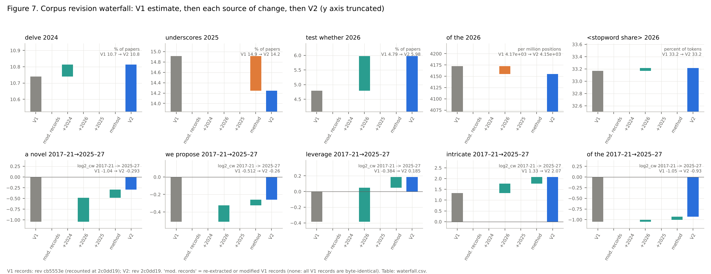
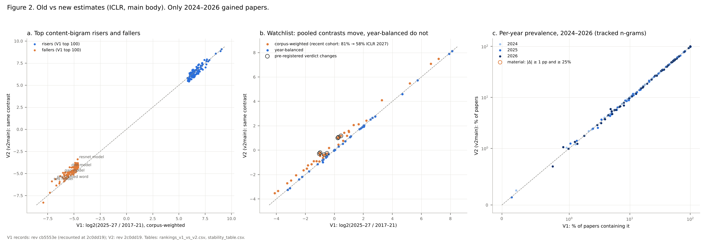
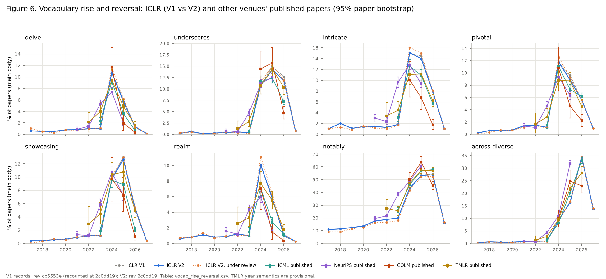

# V2 replication (Gate 2, Lane B)

_Lane B, thread "Lane B: V2 longitudinal replication". Dataset `woog/open-text-detector-papers` at
V2 pin `2c0dd192a3d3ba6605ed3f5ed5df145dddbdcb27`; V1 pin `cb5553e0c192c31c562a2822668c7f4ebbb9437a`
stays the default and untouched. Outputs: `results/v2/replication/`. V1 tables, figures and docs are
not modified._

## Pre-specified comparison rules

_Written and committed before any V2 estimate was computed._

**What can change.** Gate 0/1 established that every V1 record is byte-identical in V2 and that 52,128
records were added (`docs/v2-corpus-inventory.md`). For ICLR, only 2024, 2025 and 2026 gained records
(+1,154, +5,458, +14,565); 2017–2023 and 2027 are unchanged. Every V1/V2 difference therefore splits
into three terms, estimated separately:

1. **Modified records.** Expected to be zero. Tested by recounting the V1 records at the V2 pin with V1
   definitions (view `v1repro`) and requiring the V1 tables to reproduce exactly.
2. **Added records**, under V1's definitions unchanged (view `v2def`: every V2 record, ICLR 2025 still
   restricted to the 0-P id stratum). Split further by year (2024, then 2026) for the waterfall.
3. **Methodology.** One change only: ICLR 2025 is now 99.5% complete, so V1's restriction to the 0-P id
   stratum (made because the rest of V1's 2025 sample was biased toward accepted papers) is no longer
   needed. V2's primary view `v2main` uses the whole year minus the 140 title-slug ids. This is reported
   as a sensitivity term (`v2main` − `v2def`), not as a redefinition.

All other definitions are V1's: `omissions` config, tokenizer v1.3, content filter v1.2, statement
removal v2, main body = text before the first `⟦references omitted⟧`, version from V1's header rule,
add-5 smoothing, eligibility prevalence ≥ 1% and df ≥ 20 in the higher cohort, contrasts 2017–21 vs
2025–27 (main), 2024–26 and 2027.

**Verdicts.** For each V1 finding I take the effect V1 reported (a step, a contrast or a level change
relative to the baseline V1 used) and compare the `v2main` effect with it:

- **survives**: same direction, and the V2 effect is within ±25% of the V1 effect;
- **strengthened** / **weakened**: same direction, V2 effect more than 25% larger / smaller;
- **disappears**: the V2 effect falls below the threshold the finding used (e.g. |log2| < 0.5, or a
  step that is no longer larger than the year-to-year variation of 2017–2023);
- **reversed**: opposite direction.

For rankings (top risers and fallers), the finding survives if the Spearman correlation between V1 and
V2 log2 changes over V1's top 100 is ≥ 0.8, no V1 top-25 item changes sign, and ≥ 80% of V1's top 25
stay in V2's top 100.

Because the V1 records are a subset of V2, V1 and V2 estimates are not independent. The informative
comparison for "was V1's sample representative" is **V1 records vs added records** within the same
year, which are disjoint; those differences carry paper-level bootstrap intervals.

**Other venues.** V1's non-ICLR checks (`results/style_shift_checks.csv`) used ≤ 800-paper samples
of V1 records, which were accepted camera-ready papers only. They are compared with V2 **published-only**
cohorts, and ICML additionally without the papers whose title matches an ICLR submission of the same or
previous year (`iclr_overlap`, ~13% of ICML 2026). TMLR is split by version, and its year is treated as
provisional (Gate 1). Venue trajectories are compared within venue, not as cross-venue levels.

_Amendment after the rules were frozen (not a change of criteria): Agent E found that exact-title
matching misses about a fifth of the ICLR overlap (`docs/v2-adversarial-review.md` D3). The ICML
"no overlap" cohorts below therefore also drop Agent E's text-matched pairs
(`results/v2/review/e4_textpairs_*.csv`), which removes 16% of ICML 2026 rather than 13%._

## Results

### Summary

- **Nothing in V1 was wrong because of its sample.** Recounting the V1 records at the V2 pin reproduces
  every V1 table for 2017–2026 exactly. 2027 differs by one paper: an ICLR 2027 record is an exact
  duplicate of a record that was added to ICLR 2026, so V2's deduplication now keeps the 2026 copy
  (effect ≤ 0.3% on any top-100 count, no rank changes; `exactness_v1repro.csv`).
- **Every per-year V1 finding survives on the complete 2024–2026 cohorts**, by the pre-specified
  ±25% rule: 75 of 75 effects (the 2024 burst and its fade, the 2027 break in all versions and in the
  under-review stratum, function words and stopword share, the "across" construction). The added records
  have the same rates as V1's records within each year (table below).
- **What changed is V1's pooled, corpus-weighted contrasts.** In V1, ICLR 2027 was 81% of the
  "recent" cohort (2025–27); in V2, with complete 2025 and 2026, it is 58%. The corpus-weighted log2
  changes therefore move by a median 0.51 bits on the watchlist, while the year-balanced changes move
  by 0.02 bits. Seven pre-registered watchlist verdicts flip, all phrases whose 2027 value differs from
  2025–26: *a novel*, *we propose*, *novel approach* and *moreover* go from "down" to "flat", and
  *delve into*, *crucial role*, *plays a crucial* from "flat" to "up". V1's corpus-weighted contrasts
  were largely a measurement of 2027.
- **The top-riser and top-faller rankings survive** (Spearman 0.86 and 0.88, no sign flips, all of
  V1's top 25 still in V2's top 100). The paper-share riser list is **weakened** by the rule
  (Spearman 0.76 < 0.8, though no sign flips and all top 25 retained), for the same reweighting reason.
- **The main-body vs all-text sensitivity reproduces** (top-100 Spearman 0.80 / 0.88 / 0.99 against
  V1's 0.78 / 0.87 / 0.99).
- **Outside ICLR, the 2027-type register appears in cohorts whose final text was written in 2026**
  (ICML 2026, COLM 2026, TMLR 2026), at smaller amplitude than ICLR 2027 and largest in TMLR
  submissions and COLM. This is the replication of V1 finding 3 that V1 could not run. It is descriptive:
  it says the break is not ICLR-specific, not what caused it.

### Verdicts by V1 finding

Full table: `findings_v1_vs_v2.csv` (each row: V1 effect, V2 effect, verdict, and the year values).

| V1 finding | effects tested | verdict | note |
|---|---:|---|---|
| §1 topic turnover (top risers / fallers, log2_cw) | 2 lists | **survives** | Spearman 0.86 / 0.88; 0 sign flips; 25/25 of V1's top 25 in V2's top 100 (`rankings_summary.csv`) |
| §1 paper-share risers (pp_cw) | 1 list | **weakened** | Spearman 0.76; 0 sign flips; 25/25 retained |
| §2 2024 burst: step 2023→2024 | 6 words | **survives** | e.g. delve 1.0% → 10.8% (V1 10.7%) |
| §2 fade (2026 vs peak; 2027 vs 2026) | 12 | **survives** | |
| §3 2027 break (all versions; under review) | 20 | **survives** | baselines now on 13.7k 2026 submissions instead of 3.7k; *a novel* −44.7 pp (V1 −44.9) |
| §4 function words and stopword share | 27 | **survives** | "of the" 2024→2026 −0.61 bits (V1 −0.61); stopword share 2024→2026 −3.8 pp |
| §5 "across" construction | 10 | **survives** | across diverse 34.5% in 2026 (V1 34.1%) |
| Watchlist, main contrast log2_cw | 36 | 14 survive, 10 strengthened, 8 weakened, 3 disappear, 1 reversed | all from the cohort reweighting; year-balanced values unchanged (median Δ 0.02 bits) |
| Watchlist pre-registered hit rate | 36 | 17 → **24** held | v2def (V1 definitions) 23: one flip is the 2025 method change |
| Sensitivity: body vs all text | 3 lists | **survives** | |
| §6 disclosures (ICLR 2027 only) | — | unchanged by construction | 2027 is byte-identical |

The verdict rule is mechanical, and "strengthened/weakened/disappears/reversed" on the watchlist
reflect what the corpus-weighted contrast measures, not a change in any year's data. *leverage*
is the one "reversed": −0.38 bits in V1, +0.19 in V2, because its 2025–26 level (~50% of papers) now
outweighs its 2027 drop (12%).

### Where the V1/V2 differences come from

`waterfall.csv`. Per-year estimates barely move: the largest step is *test whether* 2026, 4.8% → 6.0%,
from the added 2026 records; *underscores* 2025 moves −0.7 pp from the 2025 method change. Pooled
contrasts move a lot, mostly from the added 2026 records (59–74% of the shift for *a novel*, *we propose*,
*leverage* and *intricate*; 34% for "of the") and the rest from using the whole of 2025. Both push the
same way: they add weight to 2025–26 relative to 2027. "Modified records" is zero by
measurement (`exactness_v1repro.csv`).

**V1 records vs added records, same year** (disjoint samples; % of papers or per million, 95% paper
bootstrap; `venues/venue_metrics.csv`, groups `v1` and `added`):

| | 2024 V1 (6,145) | 2024 added (1,152) | 2025 V1 (6,152) | 2025 added (5,453) | 2026 V1 (5,160) | 2026 added (14,553) |
|---|---|---|---|---|---|---|
| stopword share | 37.0 | 37.0 | 36.0 | 36.0 | 33.2 | 33.2 |
| "of" per million | 26.6k | 26.6k | 25.3k | 25.4k | 20.3k | 20.4k |
| delve | 10.7 (10.0–11.5) | 11.2 (9.5–13.0) | 5.8 | 5.6 | 1.2 | 1.4 |
| a novel | 55.5 | 58.1 (55.1–61.0) | 60.5 | 61.6 | 53.6 | 53.3 |
| test whether | 2.4 | 2.3 | 2.6 | 2.3 | **4.8 (4.2–5.4)** | **6.4 (6.0–6.8)** |
| across diverse | 9.1 | 10.2 | 16.4 | 16.4 | 34.1 | 34.7 |

The only difference whose intervals separate is *test whether* in 2026. V1's 2026 sample was an
id-prefix crawl (ids starting 0–F); if OpenReview ids carry any submission-time order, later
submissions may lean further toward the 2027 register. That is a hypothesis, not checked. (2025 "V1"
here is all V1 records, including the Q–z and title-slug strata that V1 excluded.)

### Stability of every tracked estimate

(a) V1's top-100 risers and fallers, V1 vs V2 log2_cw: the fallers move toward zero by about half a bit
because the recent cohort is less 2027-heavy. (b) The watchlist: corpus-weighted contrasts (orange) are
off the diagonal, year-balanced (blue) sit on it; circles mark the seven verdict changes. (c) Every
tracked n-gram's prevalence in 2024, 2025 and 2026: none changes materially (|Δ| ≥ 1 pp and ≥ 25%;
`stability_table.csv`).

### Vocabulary rise and reversal across venues

`vocab_rise_reversal.csv`. The 2024 peak and the 2025–26 decline of *delve*, *realm*, *intricate*,
*pivotal*, *showcasing* and *underscores* replicate in the complete published cohorts of ICML,
NeurIPS, COLM and TMLR, with the same word order (delve and realm peak in 2024, underscores and
showcasing hold into 2025). NeurIPS leads by a year on several words (delve 5.3% in 2023, underscores
4.8%), consistent with its earlier writing calendar (NeurIPS 2023 papers were written in spring 2023).
V1's style checks on ≤ 800-paper samples reproduce on the complete V1 records and the complete V2
published cohorts within sampling error (`venues/style_check_v1_vs_v2.csv`; TMLR 2022/23 and COLM,
where V1's sample was the whole V1 set, match to four digits).

### The 2027 register outside ICLR

Main body, % of papers (95% paper bootstrap) or per million. ICML excludes papers with an ICLR
counterpart (title or text match). Venue levels are not comparable across formats; read within rows
of one venue.

| cohort (final text written) | papers | a novel | we propose | test whether | held fixed | percentage points | notably | "of" | stopword share |
|---|---:|---|---|---|---|---|---|---|---|
| ICLR 2025 submissions (2024) | 7,552 | 62.2 | 82.2 | 2.3 | 0.1 | 1.4 | 52.0 | 25.6k | 36.1 |
| ICLR 2026 submissions (2025) | 13,684 | 54.5 | 80.2 | 5.9 | 0.7 | 4.0 | 52.3 | 20.3k | 33.1 |
| ICLR 2027 submissions (2026) | 39,881 | 8.7 | 51.3 | 22.7 | 12.9 | 24.7 | 16.5 | 13.8k | 32.0 |
| ICML 2025 camera-ready (2025) | 2,736 | 59.0 | 79.6 | 3.1 | 0.4 | 1.4 | 56.9 | 24.4k | 35.5 |
| ICML 2026 camera-ready (2026) | 5,293 | 32.9 (31.6–34.0) | 77.4 | 10.3 (9.6–11.2) | 2.1 | 4.5 | 57.9 | 18.2k | 32.3 |
| COLM 2025 camera-ready | 414 | 41.1 | 71.3 | 9.4 | 0.2 | 6.0 | 63.8 | 21.9k | 34.0 |
| COLM 2026 camera-ready | 856 | 17.6 (15.3–20.0) | 57.0 | 29.9 (26.9–32.9) | 4.4 | 13.4 | 45.3 | 16.3k | 31.8 |
| TMLR 2025 submissions | 700 | 53.4 | 69.1 | 5.9 | 1.0 | 3.3 | 54.7 | 24.5k | 35.7 |
| TMLR 2026 submissions | 1,492 | 25.2 (23.1–27.6) | 58.8 | 21.2 (19.2–23.3) | 11.9 | 13.2 | 36.5 | 18.2k | 33.7 |
| TMLR 2026 published | 1,507 | 39.9 | 66.9 | 13.2 | 5.0 | 7.0 | 56.8 | 20.6k | 33.9 |
| NeurIPS 2025 camera-ready (2025) | 5,783 | 57.8 | 78.7 | 3.5 | 0.4 | 2.4 | 60.9 | 22.2k | 34.1 |

Facts: every 2026-written cohort moves in the 2027 direction on all four 2027 markers (*a novel* down,
*test whether*, *held fixed*, *percentage points* up). The amplitude orders as TMLR submissions ≈ COLM >
TMLR published > ICML. NeurIPS 2025, written a year earlier, barely moves. "Notably" falls only in the
cohorts that move most (COLM, TMLR submissions). ICML 2026 papers were mostly drafted before 2026 and
revised by June; COLM 2026 papers were drafted around January–March 2026.

Interpretation (tentative): the ICLR 2027 "break" looks like the far end of a shift that was under way
across ML venues through 2026, and its size in each cohort tracks how late in 2026 the text was
written. That would make the ICLR 2027 step partly a calendar effect (a whole cohort written in
summer 2026) rather than something about ICLR. Not tested: TMLR year semantics are undocumented
(Gate 1), and none of these cohorts is version- and time-matched to ICLR 2027.

Test: date each TMLR 2026 record by its OpenReview submission or revision date and plot the markers
by month. A smooth rise through 2026 supports the calendar reading; a step at a fixed date supports a
shared external trigger.

## Methodological notes

- **Count merge per year.** The V2 trigram merge exceeded the container disk twice. `count_ngrams.py
  --merge-by-year` aggregates one year at a time after taking the union of per-year keep sets; on a
  test venue it gives value-identical tables.
- **`count_ngrams.py --revision`** now exists and is recorded in `run.json` (Agent E D2). All V2 runs
  here name `2c0dd19` in their `run.json`.
- **Composite strata.** `flags_v2.csv.gz` gives every record a stratum
  `<version>|<v1 or added>|<id group>`. One V2 count then yields every view by summing strata
  (`scripts/v2/replication_views.py`). The V2 flags equal V1's flags on all 76,698 V1 ICLR records
  (`flags_v1_check.csv`).
- **Contrast formula check.** This lane's own cohort log2 on the V1 records matches V1's committed
  `log2_cw` for all 437 V1 change-table bigrams (median |Δ| 3e-5 bits, max 0.01 from the one 2027
  paper; `contrast_check.csv`).
- **distinct_ngrams** in view totals counts kept n-grams only; no analysis uses it.
- **Longitudinal figure annotations.** `longitudinal.py --coverage v2` drops the "partial year"
  shading and the 2025 "id stratum" label. The `robust_without_2025_2026` column keeps V1's definition.

## Outputs

`results/v2/replication/` (revision `2c0dd19` unless a column says otherwise):

- `v2main/{body,alltext,longitudinal}`: V1's tables and figures regenerated on the primary V2 view;
  `v2def/...`: the same under V1's definitions (2025 = 0-P stratum).
- `findings_v1_vs_v2.csv`, `rankings_v1_vs_v2.csv`, `rankings_summary.csv`, `stability_table.csv`,
  `waterfall.csv`, `series_by_view.csv` (every target, every view, all versions / under review /
  published), `exactness_v1repro.csv`, `contrast_check.csv`.
- `venues/venue_metrics.csv` (every venue × year × group, with bootstrap intervals),
  `venues/style_check_v1_vs_v2.csv`.
- `figures/fig_v2_2_stability.png`, `fig_v2_6_vocab_rise_reversal.png`, `fig_v2_7_revision_waterfall.png`
  with their tables.

Reproduce: `scripts/v2/run_replication.sh` (about 1.5 h on 4 cores; needs ~25 GB free disk; intermediates
in `~/work`).
